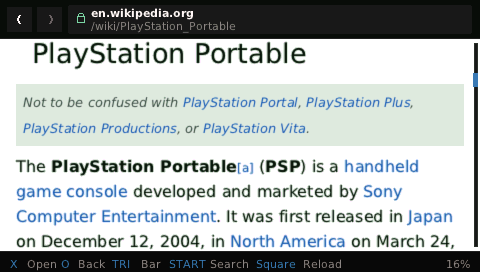
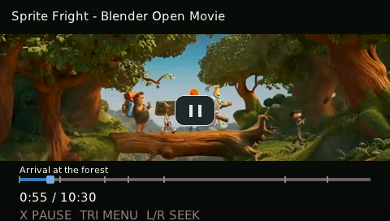
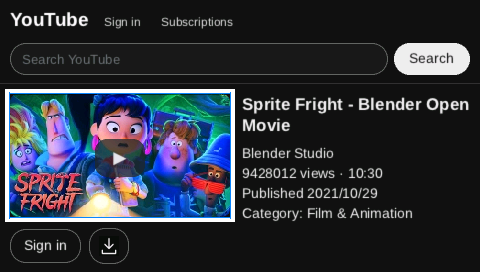
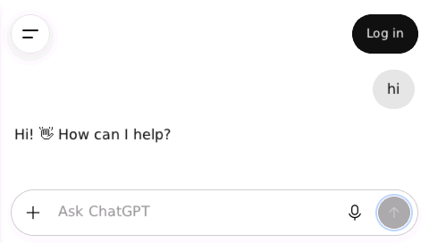
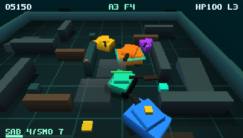
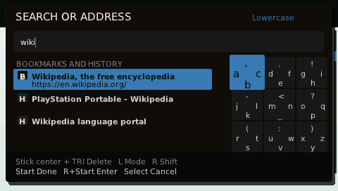

# Tilefinch

*An experimental web browser for the Sony PSP (333 MHz, 64 MB): a
from-scratch layout engine, JavaScript, and hardware-assisted video, all
running on the handheld itself.*

**[Download the latest release](https://github.com/stjanovitz/tilefinch/releases/latest)**
· [What's new](CHANGELOG.md) · [Install guide](#install)

This page is for PSP owners. If you want to evaluate or work on the engine,
skip to [How it works](#how-it-works).

| Wikipedia | 360p video playback |
|---|---|
|  |  |

| YouTube support | ChatGPT |
|---|---|
|  |  |

| WebGL games | Danzeff text entry |
|---|---|
| [](examples/treadline-arena/README.md) |  |

## Why

I picked up my PSP for the first time in about a decade and wanted an excuse
to find out three things: how far the machine could be pushed, how much of
the modern web could run in a setting this constrained, and what today's
coding agents are capable of. A web browser tests all three.

## What it does

| Feature | Support |
|---|---|
| **Web browsing** | Real HTTPS pages with JavaScript, WebAssembly and WebSockets, cookies, images, mobile layout, and TrueType text. No proxy or companion computer is involved. |
| **Native media** | YouTube (through its lightweight provider) and compatible HTML `<video>`/`<audio>` elements open in one native player. Official builds use the PSP's firmware decoder for 240p/360p Baseline/Main MP4 and 240p HLS with AAC-LC, including YouTube live streams and premieres. Seeking, buffering status, preferred audio and subtitle languages, track selection, resumable downloads, and audio-only playback are built in. An optional, separately built decoder adds 240p H.264 High, and 240p Baseline/Main streams the firmware refuses (more than 3 reference frames, B-frame pyramids). |
| **Tabs and navigation** | Five tabs, bookmarks, history, address and search suggestions, find in page, optional session restore, and optional one-tab hibernation. |
| **Ad blocking** | Conservative request blocking and cosmetic hiding are on by default. Custom uBlock/EasyList-style rules and per-site exceptions are supported. |
| **Cookie notices** | Common consent banners are hidden without clicking Accept or creating consent cookies; individual sites can be exempted. |
| **Reader, Basic view and offline** | Reader mode reflows articles; Basic view rescues pages whose scripts fail, keeping their links, tables and simple search forms. Save articles, and install small manifest-backed web apps for offline use with their icon and the same-origin resources already loaded, then update, reinstall, or remove them. |
| **Text entry** | The PSP system keyboard or the faster Danzeff radial keyboard, with completion from local bookmarks and history. |
| **Games** | Canvas 2D and a WebGL 1 subset for charts and modest games, with `ImageBitmap` asset preparation, user-started PCM game audio, page fullscreen, and the standard Gamepad API mapped to the PSP's controls. The included [Treadline Arena](examples/treadline-arena/) is a 3D WebGL tank game with a campaign, bot battles, a Practice Range and adaptive music. |
| **Appearance** | Automatic or forced page dark mode, dark and light browser chrome, downloadable color themes, page text scaling, On/Smart/Off website fonts, translated browser menus, mixed right-to-left and left-to-right layout with Arabic-family shaping, and optional Japanese, Simplified and Traditional Chinese, Korean, Cyrillic, Extended Latin, Arabic, Hebrew, Devanagari (Hindi), Bengali–Assamese, and color-emoji glyph packs. |
| **Native PSP interface** | An immediate home screen, the Library, clock, battery and Wi-Fi status, contextual controls, PNG screenshots, and diagnostics shown as photographable QR codes. |
| **Optional XMB redirect** | With ARK-4, Sony's Internet Browser icon can launch Tilefinch; holding L opens the original browser instead. |
| **Updates** | Signed in-app updates with A/B slots, a trial boot, automatic rollback, explicit approval, and an optional picker for signed earlier versions. |
| **Experimental voice search** | An optional downloadable model and on-demand speech engine. Off by default; currently slow and inaccurate. |

## What you need

- A PSP that runs homebrew (custom firmware) and has the 64 MB memory mode:
  - **PSP-3000**: the tested model. Everything claimed on this page ran on it.
  - **PSP-2000 and PSP Go**: same memory mode, expected to work, not yet
    qualified.
  - **PSP-1000**: not supported. It has 32 MB of RAM, and most sites need
    more.
  - **PSP-E1000 (Street)**: has the memory but no Wi-Fi, so only the offline
    library would work. Not a sensible target.
- About 20 MB free on the Memory Stick for everyday browsing and updates.
  - Optional glyph packs take up to about 1 MB each; the color-emoji pack
    takes about 5 MB. Besides the selected language pack, Tilefinch can attach
    up to two other installed packs when a page uses their scripts. A page
    that needs a pack you have not installed offers it in a notice you can
    ignore; installing from that notice first shows the signed download
    size and asks again.
  - Installing the optional voice model needs about 19 MB more while the
    verified download and the new copy coexist. Allow 40 MB free if you want
    voice recognition.
- A Wi-Fi network the PSP can join. With the latest ARK-4 custom firmware,
  WPA2 works; otherwise the PSP joins only WPA (TKIP) or open networks, a
  limit of its hardware era. Most routers can offer a WPA/TKIP guest network.
  Save the connection in the PSP's own Network Settings first.

## Install

1. Download the PSP install `.zip` from the
   [latest Tilefinch release](https://github.com/stjanovitz/tilefinch/releases/latest).
2. Extract it and copy the whole `TILEFINCH` folder to `PSP/GAME/` on the
   Memory Stick. The launcher should end up at
   `PSP/GAME/TILEFINCH/EBOOT.PBP`, with `slot-a`, `slot-b`, `data`, and
   `NOTICES` beside it.
3. Safely disconnect the PSP, then start **Tilefinch** from
   **Game → Memory Stick**.
4. If you have not already, save a Wi-Fi connection in the PSP's Network
   Settings. Tilefinch uses connection profile 1 unless you choose another
   in **Menu → Settings → Device & storage**.

The `.tfum` and `.tfup` files on the release page are for Tilefinch's signed
in-app updater, not for manual installation. Optional language, emoji, and
voice components are installed from their Settings screens.

### Optional ARK-4 XMB redirect

ARK-4 users can make **Network → Internet Browser** open Tilefinch. This is
an optional VSH plugin: it does not modify the PSP firmware or `flash0`, polls
nothing in the background, and writes nothing to the Memory Stick.

1. Install Tilefinch normally at `PSP/GAME/TILEFINCH/`.
2. Copy `TILEFINCH/OPTIONAL/tilefinch_xmb.prx` from the install archive to
   `ms0:/SEPLUGINS/tilefinch_xmb.prx`.
3. In ARK's Custom Launcher or Plugin Manager, install or enable the plugin
   for the **VSH (XMB)** runlevel.
4. Restart VSH or reboot the PSP.

The equivalent manual line in ARK's `PLUGINS.TXT` is:

```text
vsh, ms0:/SEPLUGINS/tilefinch_xmb.prx, on
```

On a PSP Go using internal storage, use `ef0:` in both paths.

- Hold **L** while opening the Internet Browser icon to get Sony's browser.
  Because the redirect uses L for this, Tilefinch's previous-version safe
  start is available only when you launch Tilefinch from
  **Game → Memory Stick**.
- If Tilefinch is missing or the handoff fails, Sony's browser stays open.
- To restore the original behavior, disable the plugin in ARK's Plugin
  Manager and restart VSH.

Tilefinch still runs as an ordinary homebrew application, not as code inside
VSH, so leaving it reloads the XMB and may show the usual Sony or ARK startup
screen. After replacing the plugin file itself, power the PSP off completely
and cold-boot it: Restart VSH can keep the previous `NO_STOP` handler in
memory. The redirect starts Tilefinch's stable root launcher, so signed
updates, trial boots, and automatic rollback work as usual. ARK-4's
[plugin documentation](https://github.com/PSP-Archive/ARK-4/wiki/Plugins)
describes its Plugin Manager and `PLUGINS.TXT` formats.

### Optional H.264 High decoder

Official releases do not redistribute the custom H.264 and AAC decoder.
Compatible Baseline/Main MP4 and HLS, live streams included, keep using the
PSP's firmware. To add the 240p High-profile path, build the add-on from its
pinned upstream source by following
[Optional PSP software decoder](docs/DEVELOPMENT.md#optional-psp-software-decoder),
then copy its three files to `PSP/GAME/TILEFINCH/components/swdec/`. The
official EBOOT loads it as is: when the add-on is installed, the browser keeps
2 MiB more of the PSP's memory free for it at startup. A software-decoded
video needs about 10 MB while it plays; on a page that holds that much, the
page's scripts are stopped to make room, and the page says so when the player
closes.

That directory sits outside both app slots, so signed updates keep the
add-on. Update metadata records the decoder ABI: if a future update changes
it, the update screen says **Decoder rebuild needed**. When a page needs the
add-on and it is missing or incompatible, the player points to these build
instructions rather than reporting a generic video failure.

## Controls

| Button | Action |
|---|---|
| D-pad | Move focus between links and controls (hold to repeat) |
| Analog stick | Move the page cursor; hold it against the top or bottom edge to scroll (Settings can switch to direct scrolling) |
| Cross | Activate the focused item, or click under the cursor |
| Circle | Back, or cancel the current load |
| Square | Reload (starts voice input on a text field when Experimental Voice is on) |
| Triangle | Show or hide the browser chrome |
| Start | Address and search bar |
| Select | Menu: Home, Tabs, Page tools, Library, Settings, Help & diagnostics, Exit to XMB |
| Start + Select (hold together) | Give the controls to the page's JavaScript; hold again to take them back |
| L / R | Page up / page down |
| L held at boot | Safe start: boot the previous version (once an update has been installed) |

Type a URL in the address bar to go there, or anything else to search.

## Using Tilefinch

The [user guide](docs/USER_GUIDE.md) covers everyday use in detail:

- **Tabs, bookmarks, history**, and **typing** with the PSP keyboard or the
  faster Danzeff layout, with completion from your bookmarks and history.
- **Find in page** from **Menu → Page tools**.
- **Reader mode**, **Basic view** for pages whose scripts fail, and
  **saving and downloads**: saved articles, offline apps, files and videos.
- **YouTube**: search, channels, playlists, sign-in, and the native player.
- **Games and page controls**: handing the buttons to a page's Gamepad API,
  fullscreen, game audio, and direct multiplayer.
- **Screenshots**, what Tilefinch offers **when a page will not load**, and
  the **per-site controls** for JavaScript, ad blocking, cookie notices, and
  storage.

## Language support

- **Browser menus** can be shown in Spanish, French, German, Japanese,
  Russian, Ukrainian, Simplified Chinese, Korean, Hindi, Arabic, Portuguese,
  Bengali or Assamese as well as English. Translations download on request
  from **Menu → Settings → Appearance → Language & emoji → Interface
  language**. They change Tilefinch's menus, not the text of websites, games
  or subtitles.
- **Page text** in Latin script works out of the box, with compact
  fallbacks for some Chinese, Japanese, Korean and emoji characters. Signed
  glyph packs add Japanese, Simplified Chinese, Traditional Chinese, Korean,
  Cyrillic, Extended Latin, Arabic, Hebrew, Devanagari (Hindi) and
  Bengali–Assamese text, plus color emoji. Arabic and Hebrew get
  right-to-left layout. A page that needs a missing pack offers to install
  it while you browse.

Translations and packs come from
[tilefinch-models](https://github.com/stjanovitz/tilefinch-models) and are
verified before installation. The
[language-pack guide](docs/USER_GUIDE.md#other-languages-and-language-packs)
covers installing, removing and the missing-text notice.

## Updating

Check for updates from **Menu → Settings → Updates**. An optional background
check looks for new release information at most once a week and can be turned
off; Tilefinch never downloads or installs an update unless you ask.

- Stable and Beta releases are cryptographically signed and verified before
  installation. The Developer channel, which you must select explicitly, is
  unsigned and trusts the endpoint you configure.
- A new version installs into a second slot and boots as a trial. If it
  fails to start properly, the launcher returns to the version that worked,
  and holding L at boot always starts the previous version.
- On Stable, press Square on the update page to choose an older signed
  release. It installs into the inactive slot and must pass the same trial
  boot.

[docs/SECURE_UPDATES.md](docs/SECURE_UPDATES.md) and [SECURITY.md](SECURITY.md)
have the details.

## Privacy

- No telemetry, analytics, or accounts. Tilefinch sends nothing about you or
  your browsing anywhere. Requests to YouTube carry the configured video
  language (the PSP's language by default) so results and audio tracks can be
  localized.
- Everything the browser keeps stays on the PSP. Cookies live only in memory
  and are gone at power-off, except a YouTube login you choose to save under
  **Menu → Settings → Video → Save YouTube login**. History (off by default),
  the cache, saved pages and videos, screenshots, and settings are on your
  Memory Stick. **Menu → Settings → Device & storage → Site data & storage**
  lists the sites holding data and clears one of them, or HTTP caches,
  cookies, local storage, and session storage for every site.
- Site storage (`localStorage`, `sessionStorage`, and the origin-private file
  system) lives in RAM and is not written to the Memory Stick unless you
  choose. When a site outgrows RAM, Tilefinch asks before keeping that site's
  data on the Memory Stick, for this session or always, and shows how much it
  needs. **Menu → Page tools → Site information → Permissions & controls →
  Site storage** sets the choice per site, and Site data & storage sets it for
  any listed site.
- To reconnect faster, Tilefinch normally keeps the short-lived TLS resumption
  tickets that servers issue, in `data/tls-sessions.bin`. They act as
  credentials, so they stay on your Memory Stick, are sent only back to the
  site that issued them, and are erased by **Site data & storage → Clear HTTP
  caches**. **Menu → Settings → Privacy & security → TLS ticket saving** stops
  keeping them between boots without disabling connection reuse within a
  session.
- The background update check contacts the GitHub releases API at most once
  a week if enabled. It compares version numbers, sends nothing identifying
  beyond an ordinary HTTPS request, and can be turned off. Downloads you
  request—including updates, language packs and interface translations—also
  contact their published download hosts.
- **Menu → Help & diagnostics → Check Wi-Fi sign-in** makes one cookie-free
  HTTP request to `connectivitycheck.gstatic.com`, only when you ask for it or
  accept a sign-in suggestion. A detected sign-in page opens with temporary
  cookies and storage that are deleted when it closes.
- On the start page, resting on the built-in YouTube tile for about a third of
  a second opens a connection to YouTube in the background, so the site is
  ready when you press Cross. This happens only for that built-in tile, never
  for a bookmark or an address a page supplied. It sends one bodyless request
  with no cookies, credentials, or referrer and fetches no content until you
  open the site. At most one such connection exists, and it closes as soon as
  you move away or the PSP suspends.
- Voice search runs entirely on the PSP; audio never leaves it.

## Security

[The security model](docs/SECURITY_MODEL.md) documents Tilefinch's security
defaults, compatibility controls, threat model, and known isolation limits.

## Known limits

- Many sites render imperfectly and some heavy sites do not load at all;
  Tilefinch does not yet implement every web standard or API. A page that
  exceeds the memory budget degrades or stops loading instead of crashing.
- Heavy JavaScript applications are slow on a 333 MHz CPU. A large chat
  application can take most of a minute before you can type, and a reply
  takes a similar time to arrive.
- YouTube support depends on YouTube not changing; it breaks occasionally
  and updates fix it. Tilefinch does not generate YouTube Proof-of-Origin
  (PO) tokens, so videos that require one may stay unavailable even when
  browsing and search work.
- Voice search is experimental: slow, often wrong, and English only.
- Tabs remember each page's history, address, focus, and scroll position
  rather than keeping five complete pages in memory, so switching tabs
  reloads the page (from the cache where possible). Optional **Hibernate
  tab**, off by default, moves one inactive tab's record to the Memory Stick
  and marks it `[Z]`.
- Sites behind Cloudflare managed challenges do not work.
- WebGL covers conventional vertex-color and textured shaders on the PSP's
  graphics chip, not a complete programmable GPU. Complex shaders,
  transparent drawing buffers, offscreen framebuffers, and large scenes fail
  softly instead of exhausting memory or frame time.
- There is no desktop-grade process sandbox and no complete CSP. Tilefinch
  enforces a subset of response-header CSP, resource, and framing policy,
  Subresource Integrity for scripts and stylesheets, and restrictive iframe
  sandbox and origin boundaries (see
  [the security model](docs/SECURITY_MODEL.md)), but it does not isolate
  origins in separate processes. Do not use it for sensitive accounts or
  transactions.

### Reporting problems

If something misbehaves, start with [TROUBLESHOOTING.md](TROUBLESHOOTING.md).
A useful bug report includes:

- the PSP model and custom firmware (for example "PSP-3000, ARK-4");
- the Tilefinch version from **Menu → Help & diagnostics → Version & system**;
- the site or URL, and what you pressed;
- after a failure, `PSP/GAME/TILEFINCH/data/tilefinch-last-error.txt` from
  the Memory Stick. Tilefinch writes it only when **Menu → Settings → Device &
  storage → Save error reports** is On (it is Off by default), and once after
  a failed start.

Without easy Memory Stick access, **Menu → Help & diagnostics → Diagnostic
QR** shows that error report, and the Wi-Fi report when **Wi-Fi diagnostics**
is on, as QR pages you can photograph. For suspected security problems,
[SECURITY.md](SECURITY.md) explains what the project protects and how to
report.

## Building from source

The desktop lab builds and tests the same engine on your computer.
[docs/DEVELOPMENT.md](docs/DEVELOPMENT.md#quick-start) has the build steps
and the full workflow; read [CONTRIBUTING.md](CONTRIBUTING.md) before sending
changes.

## How it works

One engine runs on the PSP and in the desktop lab. Parsing, styling, layout,
scripting, and tile-based drawing all have fixed limits and share one memory
budget, so running out of memory, a malformed page, or a cancelled load is
an ordinary event rather than a crash.
[docs/ARCHITECTURE.md](docs/ARCHITECTURE.md) has the system diagrams, memory
rules, and lifecycle boundaries, and [docs/README.md](docs/README.md)
maps all of the documentation, including the engineering manuals in
[docs/engineering/](docs/engineering/README.md).

### At a glance

| | |
|---|---|
| **Hardware target** | PSP-3000: 333 MHz MIPS CPU and 64 MiB of RAM, of which pages and voice recognition share 32 MiB; a 480×272 screen, with 16-bit color for pages and menus and 32-bit color for fullscreen video |
| **Execution model** | Networking, HTML, CSS, JavaScript, layout, and drawing all run on the PSP |
| **Browser engine** | The Lexbor HTML parser, the QuickJS JavaScript engine, and Tilefinch's own style, layout, and drawing code |
| **Drawing** | Pages are kept as a list of drawing commands and painted into a cache of screen tiles, so only the parts that change are redrawn |
| **Networking** | HTTPS with certificate and hostname checks, cookies, redirects, caching, and a separate window for Wi-Fi hotspot sign-in pages |
| **License** | MIT, with separately licensed third-party components |

### Engineering highlights

| Area | What makes it interesting |
|---|---|
| **A browser, not a port** | Style, layout, painting, security policy, media, and the PSP interface are Tilefinch's own C11 code. Lexbor, QuickJS, curl, Mbed TLS, nghttp2, and FreeType are included at pinned, hash-checked versions ([notices](THIRD_PARTY_NOTICES.md)). That is enough to run ChatGPT's logged-out chat, with over a hundred JavaScript modules and a streamed answer, on a PSP-3000, helped by a script preparser, targeted style updates, and a JavaScript engine tuned with profile-guided optimization ([architecture](docs/ARCHITECTURE.md#quickjs-is-vendored-and-changed-in-place)). |
| **One memory budget** | The DOM, JavaScript, CSS, downloads, layout, and screen tiles share one 32 MiB page budget with voice recognition. Every table and loop has a fixed limit, and a refused allocation is a tested path the page recovers from. |
| **Useful pixels before the download ends** | HTML and CSS are processed as they stream in, visible resources load first, layout can pause and resume, startup scripts load only when needed, and compiled styles and scripts are cached, all so a 333 MHz CPU paints something early. |
| **Deterministic rendering** | The desktop lab and the PSP share the same layout and drawing code, down to the 16-bit color dithering. Visual-fidelity scores measured against Chrome may only go up ([fidelity workflow](docs/FIDELITY.md)). |
| **Firmware video acceleration** | Tilefinch feeds H.264 directly to the PSP's Media Engine, repairing streams that would otherwise stall it, and converts one picture's colors while the previous one is on screen ([media state machine](docs/engineering/PSP_MEDIA_SESSION_STATE.md)). |
| **Optional two-core video** | A separately built add-on decodes 240p H.264 High, Main and Baseline by sharing the work between the Media Engine and the main CPU. Official binaries leave it out. |
| **360p on a 480×272 screen** | 640×360 frames pass through video memory in two strips, and the PSP's graphics chip scales them with no per-pixel work on the CPU ([device envelope](docs/engineering/PSP_ENVELOPE.md)). |
| **Explicit lifecycle ownership** | Media and networking are written as explicit state machines that tear down step by step, so memory is never freed while the firmware or a background worker can still use it ([architecture](docs/ARCHITECTURE.md)). |
| **Security without pretending to sandbox** | HTTPS-first navigation, CORS, CSP, Subresource Integrity, protection for devices on your local network, cookie controls, and signed A/B updates, all within a documented single-process model ([security model](docs/SECURITY_MODEL.md)). |
| **Hardware-aware gates** | Changes must pass the optimized desktop test suite, backed by sanitizer, hostile-input, Web Platform Test, fidelity, and PSP cross-build checks, plus limits on executable and hot-function size ([engineering guide](AGENTS.md)). |

**Evaluating the engineering?** Read in this order:

1. [ARCHITECTURE](docs/ARCHITECTURE.md): the system and its ownership rules.
2. [SECURITY_MODEL](docs/SECURITY_MODEL.md): what fails closed, and which
   guarantees are absent.
3. The two device lifecycle contracts, for
   [media](docs/engineering/PSP_MEDIA_SESSION_STATE.md) and
   [networking](docs/engineering/PSP_NETWORK_SUPERVISOR.md).
4. The [device qualification strategy](docs/engineering/DEVICE_QUALIFICATION.md):
   which claims the host, the emulator, and the hardware can each prove.
5. [RELEASE_PROCESS](docs/RELEASE_PROCESS.md): gates, size limits, and the
   offline signing ceremony.

## Contributing

Issues and pull requests are welcome. Tilefinch is a spare-time project, so
responses and reviews may take a while. [CONTRIBUTING.md](CONTRIBUTING.md)
describes the build and test expectations.

## License and independence

See [licensing, attribution, and independence](docs/LICENSING.md) for the
project license, third-party notices, screenshot credits, and trademark
information.
