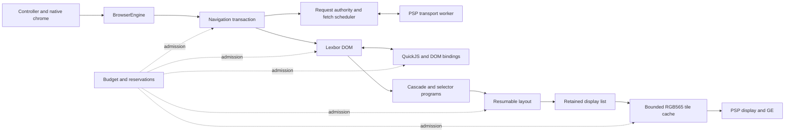
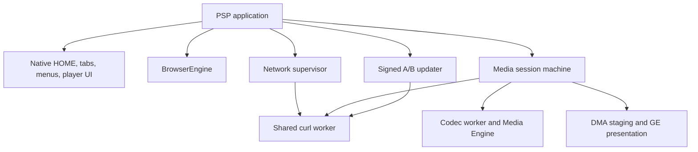
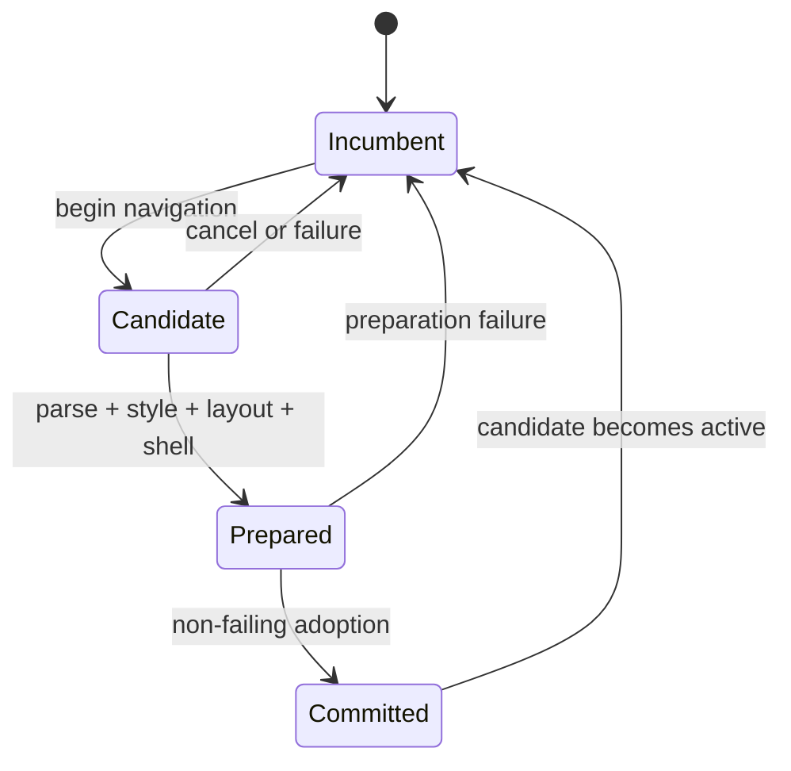
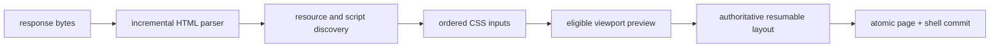

# Architecture

Tilefinch is a web browser for the Sony PSP, written in C11. Its target has a
333 MHz single-core MIPS CPU, 64 MiB of RAM, no virtual memory, and a
480×272 RGB565 screen: less memory, in total, than a desktop browser gives a
single tab. On that machine Tilefinch fetches pages over HTTPS and HTTP/2,
parses HTML and CSS, runs JavaScript, lays out modern mobile sites, rasterizes
them into tiles, and plays video through the PSP's Media Engine or a bounded
two-core software decoder.

It aims at the web as it is rather than a curated subset. A page such as
chatgpt.com loads more than a hundred JavaScript modules, hydrates a
client-side application, and streams its answer into the document. On the PSP
all of that (the DOM, the JavaScript heap, styles, layout, and screen tiles)
has to fit inside a 32 MiB envelope it shares with voice recognition, next to
a TLS stack, a network worker, and whatever the video player is doing.

## What the machine decides

A desktop browser survives a heavy page by having room to spare: swap, spare
cores, a garbage collector that can wait. The PSP has none of that. Running
out of memory is not an edge case to log; it is what an ordinary page does
unless the browser prevents it, and one stalled loop freezes the only core.
So the constraints are the design:

- **One ledger.** Every page-owned byte is admitted through a single memory
  budget, and teardown must hand every byte back.
- **Nothing unbounded.** Every variable-size structure has a fixed maximum
  or an explicit eviction policy, and a refused allocation is an ordinary
  outcome with a rollback path.
- **Everything interruptible.** Parsing, style, layout, script, and network
  work are resumable and cancellable at deterministic points, so the
  controller stays live while a page is heavy.
- **No half-built pages.** A candidate page is assembled beside the current
  one and replaces it only when it is usable.
- **Explicit ownership.** Firmware handles, DMA, transport, and
  browser-thread state each have one owner; other threads publish immutable
  results.
- **Honest evidence.** Host tests, the PPSSPP emulator, and the device prove
  different things, and a pass on one is never taken for another.

The payoff is a browser whose resource policy can be read from the source,
rather than inferred from whether a large machine happened to survive a page.

### Where the memory goes

The PSP process heap does not decide what a page may use. Page and voice work
share one 32 MiB envelope, which is also the `realistic` profile's ceiling;
the 24 MiB `BROWSER_PSP_RECOMMENDED_CONTENT_LIMIT` is only the default for
embedders that call `browser_config_init`. The profiles, the reserve outside
them, and the heap beneath them are in
[PSP envelope](engineering/PSP_ENVELOPE.md#memory-profiles).

### One tap, end to end

Pressing X on a link shows most of the system at once. The native chrome turns
the press into an input event for `BrowserEngine`, the page ownership
boundary. The link starts a navigation transaction: request authority decides
whether and how the fetch may happen, the scheduler hands it to the transport
worker (curl, Mbed TLS, nghttp2), and response bytes come back as immutable
chunks. The incremental HTML parser consumes them while the resource scanner
starts stylesheets and scripts. QuickJS runs the page's scripts against the
Lexbor DOM on the browser thread, the cascade and resumable layout turn the
tree into a retained display list, and a bounded tile cache feeds the PSP's
display and GE. Throughout, every stage is admitted by the budget and can be
paused for input or abandoned if the user cancels; the page that was on
screen stays there until the new one is ready.

## System map

`BrowserEngine` is the page ownership boundary. A frontend submits navigation,
input, and frame work through it and gets back bounded snapshots or borrowed
read-only views. The DOM, runtime, controller, render shell, and allocation
ledger cannot outlive the engine independently.

The PSP frontend adds process services around that boundary:

## The five architectural rules

### 1. One ledger owns page memory

Every page-pipeline allocation goes through `Budget`: DOM, styles, scripts,
resources, layout, display lists, tiles, session state, and allocator
metadata. The PSP profiles set 16 MiB (`strict`) and 32 MiB (`realistic`, the
app's own, shared with voice) content ceilings. These are admission limits,
not estimates of whatever heap happens to remain.

Budget categories record where memory went; they do not carve out stranded
sub-heaps. Fixed-capacity concurrent pools and inline session tables are
represented by reservations against the same ceiling. Process-lifetime state
that no page can own, such as the CA bundle and the cross-navigation TLS
session store, is bounded separately and counted in the device reserve.

Page JavaScript is layered: QuickJS carves every object of up to 504 bytes
(objects, shapes, property arrays, strings, closures, var refs) from its own
4 KiB arenas, whose 8-byte block header is also the reference count and GC
tag, and the QuickJS pool (`budget_quickjs_pool_*`) charges only
those arenas and the engine's larger blocks to the Budget as
`BUDGET_CATEGORY_JAVASCRIPT`, so a per-object allocator change belongs in the
engine's arena code, not in the pool.

A refused allocation is a normal result. Parser checkpoints, candidate pages,
layout jobs, cache insertion, and script admission all have rollback or
bounded-degradation paths. Failure injection exercises those paths, and
teardown reconciles the ledger to zero.

The consequence compounds: adding a cache or a Web API is never just another
allocation. It must state its maximum, its accounting category, its lifetime,
and what still works when admission fails.

### 2. The browser graph has one mutation owner

Only the browser thread mutates the DOM, JavaScript, style, layout, history,
cookies, cache policy, and UI state. The object graph therefore needs no
locks, and a cancellation checkpoint is a trustworthy transaction boundary.

Other threads exist only where the platform can block or where hardware
genuinely runs concurrently:

| Worker | Owns | Publishes |
|---|---|---|
| transport | curl handles and fixed response buffers | immutable response chunks and terminal status |
| raster decode | one browser-admitted JPEG arena | generation-tagged RGBA completion |
| codec | one prepared firmware job at a time | decoded audio or a generation-tagged video surface |
| DMA | framebuffer staging transfer | completion for the exact slot generation |
| audio | PSP audio submission | consumed PCM position |
| voice | optional recognizer job | bounded recognition result |
| clock/watchdog | platform timing or liveness observation | atomics and fixed records |

These are operating-system threads. A page's Web Workers are not: each
dedicated worker is another QuickJS context on the browser thread (see
[Realms, workers, and frames](#realms-workers-and-frames)), so creating one
adds a realm, never a second mutator.

Workers never walk the DOM, call page allocators, update chrome, or write
profile state. Cross-thread messages use bounded slots, generation tokens, and
release/acquire publication. Thread priorities are declared together in
`include/tilefinch/psp_threads.h`, so their ordering can be reviewed as one
system. JPEG entropy decoding, for example, runs below browser priority;
cancelling it invalidates its token without waiting, and only the browser
thread may adopt the finished pixels or trigger the resulting relayout.

The rule is enforced, not only described. The `Budget` intrusive list is
deliberately unlocked, so a build with `TILEFINCH_OWNER_CHECKS` binds each
ledger to the first thread that mutates it and reports any other thread that
allocates, frees, reserves, or reallocates through it; a worker reaching into
page state is caught at the allocation, not later through a corrupted list. A
worker that needs page-charged memory uses a `BudgetConcurrentPool` (parent
reservation on the owning thread, its own small lock for worker allocations),
and an intentional handoff calls `budget_adopt_current_thread()`. On the host
the check is on wherever tests are built and a violation aborts the test. On
the PSP, where every worker in the table lives, a qualification build opts in
and its exit report prints `tilefinch-owner-checks: budget-violations=N`;
ordinary validation builds leave it off, because a thread-identity syscall on
every allocation would distort the timing they measure.

The loading-UI supervisor, which draws chrome from the callback thread while
page work runs, is the case the check exists for. Its glyph cache is filled
on the owning thread when faces are bound (every printable ASCII glyph at each
UI scale in use), a miss on any other thread draws the built-in bitmap for
that tick, and binding and filling hold the supervisor's presentation fence.

### 3. Commit complete state, never partial state

Navigation is an incumbent/candidate transaction:

The incumbent page stays renderable while the candidate receives bytes,
parses, resolves resources, runs admitted blocking scripts, and builds its
authoritative layout. Before the old graph is destroyed, the candidate also
prepares its controller and tile shell. The final adoption only moves state
that is already owned, so it cannot allocate.

Reader presentation rides the same transaction: after admitted scripts
settle, one bounded content-shape pass classifies the page and installs a
hidden semantic extraction beside the untouched raw DOM, and Reader CSS
switches between the two without reparsing, keeping the nearest reading
position. When Reader is already active, this happens before the candidate's
first authoritative layout, so the page is not laid out twice
([Reader mode](READER_MODE.md)).

A navigation failure leaves the incumbent usable and opens a bounded recovery
surface over it (retry, Reader retry, and only the context actions that can
help); Return simply shows the incumbent again, and no action publishes half
a candidate with stale controller or render state.

The experimental compressed-section mode was the one exception to this rule.
It cut a large page into LZ-compressed sections of about 512 elements, kept
one section as live DOM, and paged between them, so replacing a section could
retire its DOM first. It was never enabled on the PSP and was retired on
2026-10-25; commit `c05276c8` is the last tree that has it (its lab flags are
in that tree's `docs/engineering/LAB_USAGE.md`).

### 4. Work is budgeted in time as well as bytes

Parsing, selector matching, scripting, layout, resource decoding, tile
rasterization, screenshots, offline saves, and installation all run as
bounded pumps. The main loop spends a quota, presents progress the user can
see, and resumes from an owned continuation. Parser-blocking classic scripts
are the bounded exception: they stay synchronous, with cooperative
checkpoints, inside the limits described in [Script admission](#script-admission).

#### Optional pumps are admitted by one declared table

The pipeline stages of a frame (input, navigation, runtime, media, raster,
present) have fixed positions in the PSP resident loop. The optional work
between them (preconnect, update installation, screenshots, offline
downloads, site-data restoration, provider pre-resolution, page idle work,
deferred images, and baseline fonts) has no private predicate at each call
site. It is admitted by one constant policy table in `src/frame_pumps.c`,
whose entries are in loop order and state which frame facts refuse a pump,
which pumps it yields to, and which contended resources (the Memory Stick, a
long idle slice) one of its slices claims.

- *Readiness* ("do I have work?") stays with the pump's owner, and is read
  from that owner at the moment of admission, never inferred from an earlier
  sample.
- *Admission* ("may I run, given everything else?") is answered only by
  `frame_pumps_admit()`. The frontend (`src/psp_app/psp_app_frame_pumps.c`)
  samples only the facts that pump's entry names, just before asking, so a
  condition is never stale and an idle frame pays for no predicate a declared
  relation does not need.

Every site asks for admission and records the slice it then consumes (the
navigation gate and exit cleanup, which must restore site data, are the named
exceptions). The loop is single-threaded, so pumps never race, but they do
contend: as a rule a frame performs at most one long idle slice and one
optional Memory Stick operation. `tests/test_frame_pumps.c` enumerates every
workload against every distinct refusal set and pins, each with a written
reason, the pump pairs that can still claim one resource in a frame, so a new
pump, a dropped yield, or a new resource claim fails until the author decides
the overlap. The table's comments and `include/tilefinch/frame_pumps.h` record
each decision; what a run reports is described with the
[`site-restore` scenario](engineering/INPUT_SCRIPT_HARNESS.md).

#### Resumable jobs

The authoritative layout is a `LayoutBuildJob` with explicit phases: flow,
compaction, visibility and focus, paint order, spatial indexing, scroll
metadata, and finalization. Partial display lists stay private to the job
until `layout_build_job_take()` publishes a complete result.

Container queries get at most one measured probe followed by one
authoritative rebuild. The probe records each container's content box as soon
as block layout knows it and logs every container-query evaluation; when
every logged result still holds against the measured geometry, the probe is
exactly what the rebuild would produce and the rebuild is skipped. Early
answers (a flex item measured before its box is final), a dropped log,
container-relative units, or a DOM change take the rebuild, and while a probe
logs, nothing that consulted a container query is taken from the reuse cache.
The bounded retained-selector cache can serve container-query sheets because
it rechecks each rule's container condition against current geometry on every
replay; allocation refusal declines it and leaves ordinary style resolution.

#### Input during long scripts

Post-load PSP runtime work arms a lazy, **owner-thread-only** cooperative UI
scope. At a checkpoint after 8 ms, the scope keeps the last completed engine
frame and copies the UI state; it then samples input at most once every
16 ms. Direction and activation presses enter the existing four-entry queue,
with visible queued-input feedback, and replay once the task returns; Circle
requests cancellation. Neither the callback-thread presenter nor
resource-worker hooks can enter the scope, native WebGL synchronizes its GE
list before returning to a checkpoint, no controller or DOM action runs
inside a suspended mutation, and no framebuffer ownership changes hands.
Page-controls capture bypasses this path so a game keeps its own input loop.

This is cooperation, not preemption: a native call with no checkpoints can
still block feedback, and page actions wait for a safe task boundary.
Validation reports the first checkpoint gap, input-to-presentation latency,
and every call of 100 ms or more that serviced no checkpoint; a queued press
alone is not a time-to-interactive pass.

#### Fast paths

PSP-specific fast paths (32-bit and fixed-point arithmetic, interned selector
programs, viewport-limited preview layout, paint-only image publication, and
bounded caches for repeated work) never change results; they are listed with
the [32-bit hot-path discipline](engineering/PSP_ENVELOPE.md#fast-paths).

### 5. Host determinism and device truth are separate gates

The host and the PSP run the same retained display list and software raster
primitives. RGB565 conversion uses coordinate-stable ordered dithering, so a
pixel does not depend on traversal order. The host lab can therefore compare
the engine against a 480×272 Chrome reference while unit tests pin exact
layout, counter, and raster behavior.

That does not make host timing a prediction of PSP timing. The host proves
logic, rollback, bounds, and visual output. PPSSPP proves the Allegrex build
and many PSP ABI paths. Only hardware proves cache coherency, module
availability, WLAN timing, Media Engine behavior, Memory Stick semantics, and
real input latency. [Device qualification](engineering/DEVICE_QUALIFICATION.md)
assigns each claim to the environment able to prove it, and
[Development](DEVELOPMENT.md#evidence-gates) lists what each gate (unit and
fault-injection tests, the frame-pump proof, owner checks, WPT, replay, the
fidelity scoreboard, build ratchets, the deterministic work record, PPSSPP,
offline device replay, and the physical PSP) proves. Performance claims come
from the device, and release builds compile logging, HTTP capture, and replay
out.

## Navigation and first paint

A document is not downloaded and then parsed. A navigation advances a bounded
pipeline:

The resource scanner starts stylesheets and eligible scripts while later HTML
is still arriving. A preview paint is attempted only when the parsed prefix
can produce visible pixels: eligible pages can paint before parser-blocking
scripts run, while pages that depend on scripts keep the correct blocking
order. Stylesheet suffixes preserve the selector compiler's and index's state,
and `@font-face` rules are discovered during the main CSS parse rather than in
a second walk. A sheet larger than its per-file cap is not discarded: the
buffered bytes are cut back to the last complete top-level rule (an
allocation-free scan that skips strings, comments, escapes, and `url()`
bodies), so no half rule is applied, and the truncation stays visible in the
resource counters.

The fetch scheduler caps active page slots, response bytes, callback work,
and elapsed pump time, and it pauses curl delivery when its bounded handoff
buffer is full. The candidate owns every continuation, so replacing or
cancelling it retires the whole pipeline without a callback reaching the next
page.

### Declarative refresh

`<meta http-equiv="refresh">` and the `Refresh` response header follow the
HTML Standard's shared declarative refresh steps, with or without JavaScript
(`src/declarative_refresh.c` parses; `src/navigation/declarative_refresh.inc`
owns the rest). Only a document's first refresh counts: the header, adopted
when the document is created, wins; otherwise the first connected HTML
`<meta>` in tree order whose content parses, in the head or the body, never
inside `<template>`, and inside `<noscript>` only when the page was parsed
with scripting off. A meta that page script inserts or changes later is
noticed through the mutation bridge and counts from that moment. The URL
resolves against the document base; no URL means the document itself.

The timer is page state on the page clock: it starts on the first runtime
advance after commit (after the load event) and pauses whenever page work
does (menus, the keyboard, media). A due refresh is followed exactly like a
page-script navigation. Non-deferring owners such as the lab load it inside
the runtime advance; the PSP app, which defers page navigations
(`browser_engine_set_defer_script_navigation`), takes it with
`browser_engine_take_refresh_navigation` after any pending script navigation
(which wins) as an ordinary cancellable navigation job. The document is the
referrer, there is no user activation, the request passes the ordinary
top-level request policy, and the load replaces the current history entry.

Any other navigation of the page (even a failed one), unloading it, or the
user editing a form field (`browser_engine_insert_text`,
`browser_engine_replace_text`, `browser_engine_backspace`) cancels a pending
refresh. Non-HTTP(S) targets are never followed but still are the document's
refresh, and a refresh in a child frame does nothing, so no frame can move the
top-level page. Two rules keep a refresh from taking the page away from the
user:

- `NAVIGATION_REFRESH_CHAIN_LIMIT` (5) bounds unattended refreshes: the sixth
  consecutive refresh navigation with no user input is stopped, the page
  stays, and the PSP status line says `AUTO-REFRESH STOPPED`. A button press,
  a typed or bookmarked address, or a user-activated link resets the count.
- A refresh to another URL is a redirect and is followed at any delay, but a
  same-URL refresh (an auto-reload or a fragment-only target) is followed only
  while the page is untouched. After any button press since load
  (`browser_engine_note_user_input`), it becomes `NAVIGATION_REFRESH_OFFERED`:
  `browser_engine_take_refresh_navigation` reports it once, and the PSP shows
  the non-modal note `PAGE WANTS TO RELOAD  SQUARE RELOADS`
  (`PSP_UI_STATUS_RELOAD_OFFER`), Square being the page's reload action. A
  reload would otherwise discard the page someone is reading at the cost of a
  full PSP load, while an unattended page still refreshes.

### Script navigations and history

A top-level navigation requested by page script keeps or replaces the current
history entry as the HTML Standard's history handling says.
`location.replace()` replaces it: the loaded document takes the entry, so
back skips the page that redirected (the same mechanism as a followed
refresh, `navigation_arm_history_replace`). The arming belongs to the next
navigation that starts, whichever it is, and only that navigation's load or
direct commit (a site adapter's page) uses it.
`location.assign()`, assigning `location.href` or a URL part, and following a
link push a new entry. `location.reload()` and a fragment-only `replace()`
keep the entry they are on, and `history.replaceState()` renames the current
entry in place without loading anything.

## JavaScript

QuickJS runs every page script on the browser thread, within a page-specific
heap limit and the shared page budget. The sections below follow a script's
path: the platform bootstrap every realm starts from; the realms a page can
own and the one scheduler that runs their tasks; how platform objects and DOM
nodes keep their identity; the vendored engine; and how page scripts,
webpack bundles, and WebAssembly are admitted.

### Bootstrap without spending the realm at startup

The platform bootstrap is generated as uncompressed QuickJS bytecode and
restored directly from read-only program data with `JS_READ_OBJ_ROM_DATA`,
with no per-navigation inflate buffer or duplicate copy. Features are split
into modules that activate lazily within fixed bounds: core DOM and event
semantics are available immediately, and larger facilities install when a
page first reaches their surface (the `Intl` polyfill, for example, on first
access to `Intl`). A generated manifest proves that the authored sources and
the committed bytecode agree.

- **Compacted source.** The generator embeds a compacted copy of every
  bootstrap source (indentation, trailing whitespace, and comments removed;
  newlines kept) and refuses to emit unless its bytecode is identical to the
  authored file's, so the bootstrap source ceiling measures code rather than
  prose. It is separate from the ceiling for authored page scripts.
- **Stripped bytecode.** The committed bytecode carries no source, line
  tables, or local-variable names, because QuickJS would copy them out of ROM
  into every realm's heap on restore. Bootstrap exceptions still name the
  module and function, and `TILEFINCH_DISABLE_BOOTSTRAP_BYTECODE=1` compiles
  the embedded source with full debug information when needed.
- **Attributed growth.** `TILEFINCH_TRACE_JS_STARTUP=1` prints the heap each
  module's evaluation retained, by QuickJS category, so growth is attributed
  before the footprint guard test trips.

### Realms, workers, and frames

Every script realm a page owns runs on the browser thread. There are three
kinds, and none adds a mutator:

| Realm | Bound | Isolation | Communicates by |
|---|---|---|---|
| same-origin nested frame | 16 contexts per parent runtime | a QuickJS context sharing the parent's heap and `Budget` | direct object access, as the platform requires |
| dedicated Web Worker | 4 contexts per page runtime | its own context and global; structured clone across the boundary | messages queued as platform tasks |
| loaded child document (`<iframe>` navigation) | 4 per page | its own `ScriptRuntime`, document, and image set | a generation-tagged, sequence-numbered message queue pumped by the owner |

A Web Worker is concurrency in the page's programming model, not in the
engine: `postMessage` crosses a structured-clone boundary into another
context, and the worker's turn runs when the single event loop reaches its
task. Its global inherits from `DedicatedWorkerGlobalScope.prototype`; names
it does not define resolve, read-only, through a fallback to the owner's
platform implementations, so each realm stays small instead of instantiating
the platform again. Values a worker API returns are created in the worker's
realm, so `instanceof` and brand checks hold there.

A loaded child document is parsed, styled, laid out, and scripted as its own
document (`SCRIPT_DOCUMENT_SCOPE_CHILD_FRAME`) and shown in its parent as an
opaque pixel snapshot at the iframe's box; the parent never reads the child's
DOM. A child mutation marks the snapshot dirty for the owner tick to refresh
(retrying after a refused allocation), and trusted input in a child notifies
user activation on that realm and every ancestor before dispatch.

Every connected `<iframe>` and `<frame>` is a child navigable, loaded or not:
`window.length`, `window[i]`, and `window[name]` answer the same WindowProxy
`contentWindow` returns, but a WindowProxy and its realm are created only
when read, so hidden frames no script touches (such as consent-management
locator frames) cost no realm. A same-origin frame evaluates in a persistent
QuickJS context whose global `this` is the child WindowProxy, and QuickJS
itself owns global and lexical bindings, so no source-scanning or
declaration-copying pass runs per evaluation. The installer lives in
`frames.js`, which `platform.js` calls with its private helpers and deletes.

Frames and workers share one retirement boundary. A failed setup or
construction releases its quota slot; eviction or termination retires the
realm before releasing its native reference, so retained functions keep their
storage alive but cannot run, pending jobs are discarded during normal bounded
draining, settled fetches remove their abort listeners, and microtasks and
delayed import retries check that the worker is still active.

### Tasks, timers, and activation

One scheduler owns every queued callback, and it makes the same distinction
the platform does. *Timers* (`setTimeout` and `setInterval`, in pages and
workers alike) run the HTML timer algorithm, with a nesting level inherited
from the scheduling timer and the 4 ms clamp beyond the fifth level, for
intervals and mixed chains too. *Platform tasks* (IndexedDB steps,
promise-returning platform operations, performance-observer delivery, worker
and `MessagePort` messages) share the bounded queue and quota but never enter
the timer algorithm, so a page's timer chain can neither delay browser
bookkeeping nor be reset by it.

The page's clock follows wall time. Each runtime advance moves the timer and
animation-frame clock by the real time since the previous advance, at most one
16 ms tick, so a faster loop cannot run timers early and a long frame lets
them fall behind instead of bunching. Frames still begin with the vblank wait
even when page work is runnable, because replacing it with a short yield
starves the lower-priority I/O threads on the device; that yield is only an
opt-in validation setting (`page_task_yield=1`).

A `MessagePort` delivers one message per task through the listener microtask
checkpoint and schedules the next only after that one finishes, which keeps an
endpoint's messages in order even when a listener posts back synchronously.
Author-dispatched events remain synchronous.

User activation is a timed realm state, not a flag held during one dispatch.
Trusted input opens a five-second transient window and sets a sticky "has been
active" bit, both exposed through `navigator.userActivation`.
Activation-gated native operations (fullscreen, resuming game audio, page
controls, starting multiplayer) ask the realm whether the window is open, and
fullscreen consumes it. A script-initiated navigation snapshots the state when
it is requested, because the host may act on it a turn later; that snapshot,
not the presence of a referrer, is what request context and Fetch Metadata
report as user-activated.

### Platform objects keep private identity

Platform interfaces are ordinary bootstrap JavaScript, so their brand must not
be forgeable or breakable from the page. The convention is uniform:

- instance state lives in a closure-held `WeakMap` captured before author code
  runs, or an owner-held private field when the state refers back to its owner;
  never in `_underscore` properties;
- constructors reject everything but a private token;
- receiver checks compare against that captured identity, not `instanceof` or
  a mutable global such as `window.navigator`.

A page that replaces `navigator`, poisons a prototype, or calls an accessor on
a look-alike gets the `TypeError` a browser would raise and cannot disturb the
real object. Native handoffs follow the same rule: the host captures what a
lazy module needs before author code runs and passes it through a temporary
global that is deleted immediately, and `Event.isTrusted` is a
non-configurable own accessor backed by the same private state. New Web API
surface is expected to follow this pattern.

WeakMap values must not retain their own keys, because this collector cannot
reclaim that ephemeron cycle. Attr and NamedNodeMap caches and generic
EventTarget listener tables therefore live in a private field on their owning
node or target, so dropping the whole graph permits ordinary cycle
collection. Nonempty namespace mirrors are the exception: the native DOM
cannot yet reconstruct all qualified-name and namespace metadata after a
wrapper is collected, so moving that data needs native-backed persistence.

### DOM node handles

Script reaches native nodes through a bounded handle table: a handle is a
slot number plus a generation, so a slot can be reused after its node is
destroyed or its detached wrapper is collected without an old wrapper ever
naming the new node. A live connected node keeps its slot even without a
wrapper, because bootstrap state (listeners, observers) is keyed by handle.
Every runtime allocates 8,192 slots at creation; the realistic profile may
grow the table once, to 16,352, when every slot is live and no dead wrapper can
be reclaimed. The growth is Budget-admitted like any page allocation, and a
refusal is the same clean `RangeError` a full table reports.

### Computed style is one generated registry

`getComputedStyle()` reports resolved values for the properties the engine
supports, and only those: a disconnected element has an empty declaration
block, and an unsupported name is absent rather than answered from a table of
initial values. A single X-macro list, `COMPUTED_STYLE_PROPERTIES` in
`src/js_computed_style.c`, generates the property table, the identifiers the
getter dispatches on, and per-row flags, so no value can resolve for an
unlisted property. Values are serialized from `ComputedStyle` fields, never
from authored text, so `inherit`, `var()`, relative units, and `!important`
are settled first; geometry properties are used values against the real
containing block, and where the cascade keeps less than CSS allows, the
serialization is exact for what is kept, which is also what is painted. A
checked-in dump of every registered property across a fixture page
(`tests/fixtures/computed-style-dump.*`) turns any change into a reviewable
diff.

Resolved styles are retained between reads and between entries into
JavaScript, keyed on `ComputedStyleInputs` (`src/js_runtime_internal.h`).
Script's own DOM writes drop only the subtrees they can restyle; every other
change that can alter a cascade (native DOM writes, parser input, stylesheet
and viewport changes, the colour scheme, container geometry, the fullscreen
element) moves the host style generation (`document_style_generation()`) or
a keyed input, which empties the cache. Removed nodes are evicted, so a
destroyed node's address cannot answer for a new one, and used geometry is
never retained.

### QuickJS is vendored and changed in place

QuickJS lives in `third_party/quickjs` with Tilefinch's changes already
applied. `cmake/TilefinchDependencies.cmake` pins the SHA-256 of `quickjs.c`
and `quickjs.h`, and a mismatch fails configure, so an engine change is an
ordinary reviewed diff plus a pin update. The patch files under `patches/`
are inputs only for lab variants, which rebuild a copy of the engine in the
build directory with their own pinned fingerprints.
`third_party/quickjs/README.md` lists every carried change in application
order.

Most of the changes serve the memory ceiling: bounded array growth that
collects near the limit instead of refusing, collection opportunities at
allocation sites upstream never checks, interruptible compilation, Latin-1
string storage, and in-place appends to a sole-owned string, so the `s += x`
loops common in minified decoders amortize instead of copying.

**Lazy functions and the validating preparser.** A function whose source is at
least 128 bytes gets no bytecode when its script compiles; its body is
compiled on first call. At load time a preparser that builds nothing checks
the body, following the real parser's token decisions and early-error rules,
so a script with a syntax error anywhere is still rejected before any of it
runs, and records which enclosing variables the body may capture. Anything it
does not model falls back to the full parser, and a first-call compile whose
captures disagree with that record fails loudly rather than reading the wrong
binding.

**Build.** The PSP image is optimized for size, except QuickJS, which is built
at `-O2` because the larger engine is faster on the device despite the
instruction cache. Release builds add profile-guided optimization trained
under PPSSPP on a recorded chatgpt.com session
(`scripts/train-quickjs-pgo.sh`). The profile is fingerprinted on the
engine's sources, headers, compiler, and flags, configure refuses a stale one
(which would make the engine larger and slower than none), and
`scripts/cut-release.sh` requires an explicit choice.

**Compact arrays.** A dense `Array` built only from one-character Latin-1
strings, bytes, or signed 16-bit integers is stored packed in a string-shaped
backing store, one or two bytes per element instead of a boxed value, which
keeps a decoder's or bytecode interpreter's working arrays inside a PSP script
heap. The representation is invisible to the language, and its invariants are
the ones every packed representation here must keep:

- the backing store belongs to the array alone: anything that would hand it
  to JavaScript (`join('')`) returns a copy, and mutation is copy-on-write
  whenever the store is shared or interned;
- a value the representation cannot hold widens it in place or converts the
  array to boxed elements, checked first against the device-profile array
  ceiling, since packed storage admits up to eight times more elements under
  the same byte cap;
- re-packing is only an optimization, and a refused allocation leaves the
  boxed array and the append untouched.

### Script admission

Page scripts are admitted by source size, count, heap, time, and callback
work, and interrupt checks cover QuickJS execution and native callback
boundaries. The PSP app admits a script by the memory its compile needs
rather than by its size ([PSP envelope](engineering/PSP_ENVELOPE.md#memory-profiles);
`include/tilefinch/script_admission.h`).

- **Blocking scripts stay synchronous.** Parser-blocking classic scripts run
  synchronously and in source order, including `document.write()` insertion
  checkpoints. Their cumulative source work draws on the live realm's finite
  source allowance (clamped by the realm, raised by memory-based realm growth
  only within its hard ceiling), and fetched or validated bodies count even if
  execution fails. This is bounded synchronous execution with cooperative
  checkpoints, not resumable evaluation or a worker thread.
- **Size is not suspicion.** Large cross-origin classic scripts are treated
  like same-origin application bundles: size, loops, or dynamic-code tokens
  alone do not prove they should be refused. A lexical scan of their content
  is watchdog telemetry, not an admission oracle; per-file and count limits,
  working-set and presentation-reserve admission, the shared heap, and the
  compile/execution watchdog decide.
- **Data, not code.** Inert JSON script types stay DOM data. A narrow
  classic-script subset (`window`, `globalThis`, `var`, or bare global
  assignments of strict JSON) installs its data without compiling bytecode or
  consuming executable quota.
- **No `nomodule` fallback.** Because the engine supports modules, classic
  `nomodule` scripts are rejected before preload, quota admission, or
  dynamic-script scheduling, and a module failure never enables the legacy
  alternative.
- **Hydration rollback.** Before the first parser-blocking author callback,
  the stream keeps at most one complete, visibly useful snapshot of the body.
  If later hydration fails or runs out of quota and collapses that content,
  commit restores the snapshot transactionally; a useful replacement that
  succeeds stays authoritative.
- **Circuit breaker.** One navigation's parser stage may spend at most the
  realm's source allowance in source work, twenty seconds across its blocking
  checkpoints (the PSP shows "PAGE SCRIPTS NS OF 20S" once a load has spent
  three), or three consecutive failed scripts. When a bound trips, the
  remaining blocking scripts are soft-skipped, parsing continues, the page is
  marked Limited, and the author realm is retired for that document so
  queued deferred, asynchronous, and dynamic work cannot resume the abandoned
  hydration.

Compiled scripts are reused, never trusted. ES modules and classic scripts
each have a bounded session table of bytecode keyed by the response, the
top-level site, compile options, and the SHA-256 of the exact source,
consulted only after every fetch check and evicted by the page Budget before
it refuses any allocation; an opt-in tier keeps the records on the Memory
Stick across launches ([Storage](STORAGE.md#compiled-script-caches)).
Modules of 8 KiB or more are compiled without their source text, so their
functions' `toString()` returns the native-code form. The only other
compiler artifact written to storage belongs to an installed offline app:
bytecode bound to its retained source and to a dedicated QuickJS bytecode
ABI, with launch compiling the source whenever restoration fails.

### Lazy webpack bundles

A classic script shaped like a webpack chunk registration
(`(self.webpackChunkX=self.webpackChunkX||[]).push([[ids],{key:factory,...}])`,
whose factories are most of its bytes) is not compiled whole. The planner
(`src/script_lazy.c`) finds the factories with a bounded lexer pass;
registration replaces each with a small native trampoline and keeps its exact
source compressed (`src/js_lazy_webpack.c`); a factory is compiled the first
time it runs and its bytecode is dropped after the call, so the many factories
a page never runs cost no compile. Anything the planner does not take, and any
bundle whose plan fails or whose registration does not compile, goes through
the ordinary eager path, one compile of the whole script. A bundle record
([Storage](STORAGE.md#compiled-script-caches)) lets a later load of the same
bytes skip the planner.

**Syntax errors: a deliberate deviation.** A factory's syntax is checked when
it first runs, not before. An error in a factory that never runs is never
reported; one in a factory that runs makes that call (webpack's `require`)
throw a `SyntaxError` naming the bundle's URL and the error's position, which
reaches the page's error reporting like any exception, and the other
factories, some of which may already have run, keep working. Chrome would
have rejected the whole file. The justification is cost against risk:
checking every factory up front is most of a lazy bundle's load cost, mostly
for factories that never run, and a bundle that does not parse is broken in
every browser. The planner, whose wrong cut could turn valid code into a
runtime `SyntaxError`, is checked token for token against the census corpora
and by `tests/test_script_lazy.c`, and a plan that does not cover the whole
registration takes the eager path. `TILEFINCH_LAZY_WEBPACK_PREFLIGHT=1`
restores the up-front check for A/B measurement.

### WebAssembly

Small WebAssembly modules use the standard JavaScript API through the
[bounded WebAssembly profile](WEBASSEMBLY.md). Host labs link the pinned
interpreter directly; the PSP EBOOT keeps only a versioned adapter and loads
the interpreter lazily from the active signed slot on first namespace access.
The module, runtime pool, memory, imports, exports, stack, and native
instruction work all have fixed ceilings. Unsupported proposals and import
kinds fail through the API without weakening the page's Budget, origin, CSP,
or transport policy.

## DOM mutations and style invalidation

DOM mutations are journaled and coalesced before they trigger style and
layout. The journal is bounded (256 records a turn, with a shared pool for the
class tokens a write changes). When it fills, the engine keeps up to 16
subtree roots that hold the unrecorded changes and restyles those, falling
back to a full reset only when a root cannot be named.

Invalidation is scoped by what the sheet's rules can read. A class, id, or
attribute change restyles the element plus the elements that carry the
subject key of a rule reading it from elsewhere (siblings included); focus
moves and inline custom-property writes are scoped by keyed `:focus-within`
rules and by which retained styles read which custom properties. A changed
child list restyles the parent and its children unless a sibling test reaches
their descendants, and an append after the last sibling (or removal of the
last element child) restyles only the parent and that subtree when no sibling
test counting from the end can see it. Each record also says whether it can
move a `:has()` answer: the sheet's `:has()` rules are classified once (where
the anchor lies relative to the subject, which region the argument reads,
which keys each must carry, at most 2048 occurrences), so a relational change
drops only the cached styles those answers can reach
(`src/style_has_invalidation.c`).

Computed styles are retained in a table that grows by powers of two from 1024
to 4096 entries when a full walk is about to cover more elements or a build
evicted more than a sixteenth of it, provided the budget keeps 2 MiB to spare.
The table has to cover the walk: a document-order walk through a smaller LRU
table evicts each entry before the next build reaches it.

A journal whose every change stays inside content that renders nothing (a
consent stub's `display:none` locator `<iframe>`, a script appended to
`<body>`, writes inside a closed menu) skips the relayout altogether
(`navigation_mutations_are_hidden_only`). Each record must lie inside an
element that computes `display:none` now and rendered nothing before, and
must not be able to restyle anything outside it through `:empty`, sibling
position, or `:has()`. Paths through `<head>`, inline SVG, form option lists,
media and picture sources, plugins, and image maps never skip, nor does a
hidden list item, because layout numbers list items whether or not they
render. A head `<script>` is inert only when no `:has()` anchored at `<head>`
or `<html>` can see it (`stylesheet_head_change_reaches_outside`).

## Rendering and presentation

Layout produces a retained display list of text, fills, borders, images,
stacking contexts, transforms, clipping, fixed and sticky geometry, and focus
metadata. The renderer rasterizes 128×128 RGB565 tiles on demand and keeps a
bounded spatial index, so scrolling costs work in proportion to the visible
content, not the document's length.

Unsupported motion resolves to one coherent static presentation: final
visibility and opacity are kept, scroll-linked transforms flatten, and
synthetic spacer scenes are contained. Layout records the first coordinate
clamp and confines a saturated non-root subtree, so the coordinate sentinel
cannot blank every later scroll viewport.

Mixed-direction page text is a sparse extension of the same retained layout,
not a second document representation. Ordinary left-to-right paragraphs
bypass it; admitted right-to-left paragraphs keep their logical DOM text while
a bounded UAX #9 analysis produces levels, contextual forms, shaped advances,
visual line order, and logical-to-visual glyph sidecars that painting, links,
controls, focus, and find all share
([Bidirectional page text](TEXT_BIDI.md)).

Simple focus changes update retained paint instead of laying the page out:
up to 64 rounded controls reserve one inset-ring command during layout whose
color, opacity, and thickness focus then changes in place with bounded damage,
after a dry run proves every old and new focus target and with layer order
and geometry fixed. Complex or changing shadows, background clipping,
inherited or relational effects, and exhausted slots fall back to
authoritative layout, and expanding a section is always a layout operation.

Web content and native chrome are separate layers. The browser frame stays
stable while menus, find, the keyboard, loading status, and player controls
animate over it. Mode-specific painters are deliberately out of line, so the
per-frame browser and media compositors stay small enough for the Allegrex
instruction cache; the ELF build ratchets those hot symbols separately from
total `.text`. Fullscreen video keeps the decoder's 8888 scanout and composes
the player's overlay only inside bounded rectangles
([YouTube and media lab](engineering/YOUTUBE_VIDEO_LAB.md#psp-decode-and-presentation)).

Images are decoded without forced-dark color inversion. Dark mode transforms
authored foreground and background colors at paint boundaries, while
photographs, thumbnails, and decoded video keep their source colors.

Games and interactive pages use the four bounded native surfaces below. Their
author-facing limits are in the [Game Profile](GAME_PROFILE.md) and the
[WebGL guide](WEBGL.md).

### Canvas 2D

Canvas 2D keeps two copies on purpose: an exact, lazily allocated RGBA backing
array inside the page's QuickJS budget, and at most four budget-owned native
snapshots. The JavaScript array is the exact mutable state that
`getImageData()`, export, and canvas-to-canvas drawing require; the native
snapshot is a stable presentation generation the renderer may read while
author code keeps changing the canvas. Removing either copy without first
moving exact readback and generation ownership into a native surface would
trade memory for stale-frame races or visible pixel changes.

The native raster seam draws real Tilefinch glyphs, coverage-antialiased
paths, gradients, and transformed sprites under bounded clips, and degrades
complex shadows to one offset sample so blur work never grows with page
input. Drawing crosses into native code in bounded batches, and all drawing
in a turn coalesces into one dirty rectangle whose rows are copied into the
snapshot, invalidating only the affected tiles, so a same-size animation
rebuilds no style, layout, or display list. Animation-frame callbacks run at
most once per presented tick and skip elapsed frames rather than replaying a
backlog; native surfaces, the media player, and suspend drive Page Visibility
at a task checkpoint, preserving a suspend/resume pair even when both edges
arrive before JavaScript resumes. Authored dimensions are scaled down to the
PSP surface envelope, and deep clip stacks or excess raster work fail softly
while the rest of the page stays usable.

### Gamepad and fullscreen

The Gamepad API exposes one standard-mapped controller for the built-in PSP
controls. It stays disconnected until the user holds Start+Select or a
trusted Play click calls `navigator.tilefinch.requestPageControls()`, which
shows a native exit notice and suppresses the activating face button until it
is released. Native input authority is a small, generation-bearing capture
record: navigation, native media, or suspend disconnects the controller and
returns control to the browser. Identical physical samples do not cross into
QuickJS, button and axis objects are reused across polls, and cross-origin
child frames never receive the snapshot. The held chord always returns
control, and the firmware HOME callback sits outside page capture.

The page Fullscreen API is a single top-level presentation state. A trusted
activation commits the element's identity before native chrome is hidden;
Triangle or Start+Select exits immediately, and navigation or node retirement
clears the borrowed handle. The PSP has no separate compositor top layer, so
style resolution gives the active element a fixed viewport-sized box and
supports `:fullscreen` without adding a spoofable DOM attribute.

### WebGL

WebGL 1 is a lazy, bounded command translator over the PSP graphics engine
(GE), not a software GLSL interpreter. The JavaScript layer admits only shader
shapes the GE's fixed-function pipeline can run and snapshots each draw's
state into a bounded, versioned command batch that the native side validates
again before the GE sees it, so malformed geometry or unsupported state is an
ordinary WebGL error or context loss while the document stays usable. Every
WebGL resource has a fixed per-realm ceiling, all page-owned graphics memory
is charged through `Budget`, and the GE's EDRAM targets and command ownership
are shared with the media presenter rather than adding a second graphics
authority. GE synchronization is the ownership boundary before CPU readback,
and the drawing buffer is opaque because the GE's alpha channel doubles as its
stencil plane. The [WebGL guide](WEBGL.md#how-the-psp-path-is-built) has the
translator, publication paths, and probes.

### Game audio

Game audio is another lazy, bounded module, not a second media player. One
`AudioContext` decodes a few PCM WAV buffers into a fixed native pool and
mixes a few voices, including generated oscillators, on a PSP audio worker.
Parameter changes publish packed atomic coefficients that the worker samples
once per mixer block, start and stop times use a wrapping 32-bit
output-frame clock, and no synthesis path allocates or does floating-point
work on the audio thread.

The context starts suspended and resumes only on trusted activation. Suspend
and native page media release the scarce PSP audio channel while keeping
decoded effects, so game sounds cannot take the video player's channel. A
finished voice keeps its generation-bearing slot until the browser thread
takes its completion notice and dispatches `ended`, so worker code never
enters JavaScript and a late completion cannot target a newer sound.
Compressed formats, custom graphs, long-horizon scheduling, and PCM readback
fail explicitly.

## Request authority, transport, and cache provenance

Every page-originated request crosses one construction boundary. Callers
supply a typed `TilefinchRequestContext`, and
`fetch_prepare_page_request_context()` derives cookies, Origin, Referer, Fetch
Metadata, credentials, CORS, CSP, mixed-content and Private Network Access
policy, content blocking, and cache-partition authority. Validation rejects
page requests that bypass that preparation marker.

Response security fields are parsed once, while the complete wire headers are
available, into typed metadata, so CORS, CORP, CSP, HSTS, nosniff, frame
policy, and referrer-policy consumers never reinterpret a truncated generic
header snapshot. Resource-cache entries carry their partition and
authorization grant, and entries that carry authority stay in memory rather
than being serialized as generic cache records.

On the PSP, one shared transport worker owns curl, with lazily grown response
lanes, two larger media range windows, and one bodyless HOME preconnect
descriptor. Redirects stay singular: the browser authorizes one hop, the
worker executes it, and the next hop starts only after the browser accepts
the result, while independent requests and HTTP/2 multiplexing still run
concurrently.

An authoritative navigation supersedes its incumbent page's unfinished
optional network work before queuing the candidate document, so thumbnails,
fonts, scripts, and page fetches cannot hold every worker descriptor ahead of
the link the user just activated. The incumbent DOM and last frame stay intact
for rollback, but superseded requests are not restarted if the candidate
fails: a deliberate responsiveness tradeoff until the transport has a
separate authoritative-priority lane.

The release owns its curl, Mbed TLS, and nghttp2 chain. Archives are
digest-pinned, runtime provenance is checked, HTTP/2 is negotiated through
ALPN with HTTP/1.1 fallback, and HTTP/3 is out of scope. TLS sessions are
kept by default in a bounded, checksummed, same-site store cleared with cache
data; a preference disables keeping them across boots without disabling
reuse within a process.

WebSockets reuse the same curl worker, TLS state, cookie authority, and
`connect-src`, mixed-content, and Private Network Access decisions instead of
a second network stack. A socket holds one bounded receive message and bounded
outbound data, a single published receive event provides backpressure, and
all of it is charged to the page `Budget`. The host build keeps the native
duplex lane unavailable and tests the JavaScript lifecycle through an
injectable seam; only the Allegrex build links curl's WS/WSS framing.

Installed offline games have a separate, explicitly user-activated direct
multiplayer lane, resembling the message portion of `RTCDataChannel`, with
bounded LAN discovery, STUN endpoint discovery, numeric-code exchange, and
host approval. The PSP worker owns DNS and UDP behind fixed command and event
rings; one session, small datagrams, and fixed deadlines keep it inside the
page `Budget` and the network supervisor. Ordinary pages cannot open it,
launching an offline app does not request Wi-Fi, leaving the document
cancels the worker and its lease, and there is no relay, background lobby,
or general page UDP API
([Direct multiplayer](MULTIPLAYER.md)).

### Provider caches

The native YouTube provider keeps a few generated pages and parsed watch
facts in short-lived, optional session caches keyed by URL, presentation, and
cookie authority. Reclaim and every clear action drop them, raw responses are
never kept, and jobs copy facts rather than borrowing an entry across a pump
([YouTube and media lab](engineering/YOUTUBE_VIDEO_LAB.md#provider-caches)).

[PSP transport](engineering/PSP_TRANSPORT.md) and the
[security model](SECURITY_MODEL.md) define the exact protocol and policy
boundaries.

## Explicit lifecycle machines

The two device subsystems with the most dangerous teardown ordering are
driven by pure, host-testable reducers.

### Network supervisor

The network supervisor reconciles demand (`off`, `ready(profile)`, suspend)
with the PSP's physical network state. Its inner APCTL and module ladder is
pumped rather than hidden inside a blocking effect. Consumers hold
generation-bearing transport leases. Network teardown closes admission, drains
the leases, leaves APCTL, then unwinds the owned rungs in reverse order.

A timeout never unloads the stack beneath a worker still executing inside it;
the stack is kept, with an explicit wedge obligation, until the lease retires.
Link errors are treated as hints and followed by an APCTL probe, so an HTTP
error or a CDN rate limit cannot spuriously restart networking. The full state
and event contract is in
[PSP network supervisor](engineering/PSP_NETWORK_SUPERVISOR.md).

`Ready` means the PSP stack is associated and has an address, not that the
access network grants Internet service. Captive-portal discovery is a
separate, user-initiated frontend operation: one bounded probe may open an
ephemeral tab and session authority, then re-probe and restore the incumbent
tab. It adds no portal guessing to the network reducer and never relaxes TLS
globally. The isolation and origin rules are in the
[security model](SECURITY_MODEL.md#captive-portal-sign-in).

### Media session

The media controller distinguishes opening, priming, playing, paused,
buffering, seeking, recovery, dormancy, quiescence, suspend, and failure.
Transitions produce commands; codec drain, DMA join, transport cancellation,
and pipeline release return completion events. No state that owns a pipeline
can jump directly to a resource-free terminal state.

The player has one packet pipeline, whatever the source. The built-in provider
supplies resolved split or progressive streams, offline downloads supply
bounded local files, and compatible page `<video>` and `<audio>` elements
supply authorized progressive MP4/M4A or HLS URLs. Every source keeps its
response authority and feeds the same decoder, buffering, clock, and
presentation services, and media bytes stay in RAM. Presentation follows
media timestamps, uses bounded startup preroll and adaptive rebuffering, and
records claimed, staged, and displayed identities instead of treating an
attempted present as success.

- **Decoder choice.** The stream's actual SPS picks the backend before any
  decoder is built. Baseline and Main within PSP bounds use the firmware
  bridge, whose generation-tagged surfaces discard stale completions and
  quarantine a surface whose reader timed out rather than hand it back to a
  writer. Compatible High-profile streams use an optional, user-built
  software decoder outside the A/B slots, which keeps its allocations in one
  admitted arena and, once it owns the Media Engine, keeps every later route
  until suspend or exit.
- **Sources.** MP4 probes with one standard Range request; HLS keeps a bounded
  live-edge window and one video and one audio MPEG-TS source, and refuses
  variants it cannot play as unsupported rather than as decoder failures.
  Audio-only playback is a routing choice that never builds video machinery.
- **Tracks, subtitles, and page data.** Track catalogs are bounded, an audio
  change is a generation-safe reopen at the current position, and subtitles
  are optional presentation data that never change playback state. Media found
  in page data comes from bounded, allocation-free scans that still pass URL
  resolution, CSP, request authority, and media probing, and never override
  authored media or handlers.

The control contract is in
[PSP media session](engineering/PSP_MEDIA_SESSION_STATE.md); sources, decoder
choice, the software decoder, page-data discovery, and the host and device
seams are in the [YouTube and media lab](engineering/YOUTUBE_VIDEO_LAB.md).

## PSP frontend ownership

The frontend separates ownership from control:

| Structure | Contains | Must not contain |
|---|---|---|
| `PspProcessResources` | paths, boot configuration, native presentation, text input, clock ownership | media/network policy |
| `PspBrowserResources` | engine-lifetime handles and service objects | duplicate lifecycle authority |
| `PspInteractiveState` | one loop invocation's input, recovery, and validation records | resource ownership decisions |
| `PspEngineViews` | one refreshed snapshot of borrowed engine state | independently refreshed aliases |
| `PspExitPlan` | tagged reason and handoff | teardown obligations |
| `PspShutdownReport` | independent retained/quarantined obligations | user intent |

`psp_app_run_interactive()` is the resident loop: a cold driver that sets up a
`PspLoop` (what one frame leaves for the next, plus the borrowed owners), calls
`psp_loop_frame()` once per frame, and tears down. A frame is a fixed sequence
of steps whose order is load-bearing (frame pumps admit work by position).
Work a frame does not always do lives in named `psp_loop_*` steps behind the
check that guards it: suspend/resume, update checks, a navigation's end, the
offline download slice, and the validation-only drivers. Steps a page or media
frame runs every time are hot boundaries measured together by the build (see
[the PSP envelope](engineering/PSP_ENVELOPE.md)); a new feature that runs every
frame joins those sets, and one that does not becomes a step behind its own
check. `psp_browser_close()` first drives the media and network machines to
safe terminal states, then frees only the resources their reports mark
releasable. Owners release resources; machines decide when release is safe.

### Boot and HOME

HOME and Collections are native chrome, not hidden HTML documents, so they
render from bounded profile snapshots before networking starts. The native
HOME placeholder owns neither an unused QuickJS realm nor an HTTP worker.
Wi-Fi warm-up, secure entropy, the TLS-session store, the trust bundle, the
shared HTTP worker, the remaining baseline fonts, and site-data restoration
are prepared after HOME's first paint, in separate units that yield to input
and navigation; none is a prerequisite for showing HOME or taking its first
input, and activating a tile acknowledges the press before any of them
finishes. The ordering, the font staging, and the boot timeline are in
[PSP envelope](engineering/PSP_ENVELOPE.md#boot-order).

Five tabs keep navigation, scroll, focus, find, and thumbnail facts, but only
one engine page graph is live. Optional tab hibernation and session restore
serialize bounded navigation facts, never a DOM or JavaScript heap.

## Storage and updates

Normal frame, input, style, layout, raster, and playback paths never touch the
Memory Stick. Profile changes are coalesced, caches are optional, and large
jobs such as screenshots, offline articles, video downloads, and update
installation progress through bounded pumps. Files with crash-sensitive state
use temporary files, flushes, versioned records, and atomic publication suited
to PSP FAT behavior. [Storage](STORAGE.md) is the authoritative map of files
and write frequency.

Session state that pages can write is bounded per kind and keyed by an origin
the native layer derives from the document URL, never one the page supplies.
Web storage and the origin-private file system (secure, non-opaque origins
only, while site data is allowed) share one per-origin store: each site
starts with a small RAM allowance that grows while memory allows, and a site
that outgrows RAM can be moved to a Memory Stick log for the session or for
good, with the user's consent ([Storage](STORAGE.md#site-storage)). Writer
generations ensure that a stream opened before a site-data clear cannot write
into the cleared store.

Manifest-backed offline apps extend the same library rather than adding a
second runtime. Installation serializes the committed document and a bounded
view of the live same-origin HTTP cache that keeps typed resource grants and
module provenance; launch restores that view before committing the saved
document under its original URL. Installation may precompile a bounded
number of classic scripts without running them, but their source always
remains authoritative. The design supports small self-contained games
without Service Workers, background execution, or an offline-only
authorization bypass ([Offline library](OFFLINE_LIBRARY.md)).

The updater uses a stable launcher and A/B browser slots. A compact binary
manifest signs the release sequence, exact file sizes, and digests, and the
launcher anchors verification in the public root embedded by the PSP preset;
private signing keys never enter the repository or a release package. Trial
boot and health confirmation are journaled, so a failed slot returns to the
last healthy one. [Secure updates](SECURE_UPDATES.md) defines the formats and
recovery rules.

## Source map

The main ownership boundaries are deliberately visible:

- `src/browser_engine.c`: public engine lifetime and facade, with feature
  regions in `src/browser_engine/`, each included where it sits in the facade:
  - `provisional.inc`: provisional preview painting and capture;
  - `history_focus.inc`: history focus and form-control restore,
    same-document history actions, autofocus;
  - `provisional_input.inc`: provisional preview viewport, scroll, focus,
    activation;
  - `find.inc`: find in page and text anchors;
  - `reader_recovery.inc`: Reader and Basic views, blank-page recovery,
    declared media card;
  - `youtube.inc`: YouTube provider state machines, native controls and
    idle pumps (state in `BrowserEngineYoutube`);
- `src/navigation.c` and `src/navigation/`: candidate loads and commit. The
  owner includes each file once, in this order:
  - `page_lifecycle.inc`: timing slices, stylesheet and layout builds,
    script realm creation and retirement, resource fingerprint, damage;
  - `frames.inc`: child frames, cross-frame messaging, frame presentation;
  - `declarative_refresh.inc`: `<meta http-equiv="refresh">` and `Refresh`;
  - `configuration.inc`: session setup, hooks and policy setters;
  - `document_stream.inc`: the streaming parse and speculative preloads;
  - `stylesheet_checkpoint.inc`: render-blocking stylesheet checkpoints;
  - `stream_runtime.inc`: stream staging teardown and the streaming realm;
  - `parser_script_checkpoint.inc`: parser-blocking scripts and refusals;
  - `commit_transaction.inc`: candidate adoption (`navigation_commit_document`);
  - `progressive_preview.inc`: progressive and retained previews;
  - `commit_html.inc`: whole-document commit entry points;
  - `load_state.inc`: the load job, response handling and retries;
  - `history.inc`: history, same-document URLs, fragments, scroll;
  - `mutation_classify.inc`: script mutation journal classification;
  - `style_sources.inc`: incremental style-source append;
  - `layout_reuse.inc`: layout reuse cache around a relayout;
  - `relayout.inc`: relayout, layout completion, user CSS transaction;
  - `deferred_images.inc`: retarget, web-font fallback, deferred images,
    background resources;
  - `runtime_advance.inc`: blank-page recovery and the runtime advance;
  - `events.inc`: event dispatch and frame activation;
- `src/style*.c`, `src/layout*.c`, `src/render.c`, `src/render/`: the visual
  pipeline;
- `src/js_runtime.c`, `src/js_*`, `src/bootstrap/`: JavaScript and Web APIs;
- `third_party/quickjs/`: the vendored, in-place-modified engine and the list
  of changes it carries; `patches/`: inputs for lab variants;
- `src/fetch.c`, `src/fetch/`, `src/request_context.c`, `src/session.c`:
  transport policy and browser session state; `src/session_cookies.c`: the
  cookie jar and request overlay; `src/session_site_storage.c`: site storage;
- `src/media_*.c`, `src/psp_media_*.c`, `src/media_backend_psp.c`: media;
- `src/frame_pumps.c`: the declared admission policy for optional frame work,
  whose facts `src/psp_app/psp_app_frame_pumps.c` samples;
- `src/psp_network*.c`, `src/psp_app/`: PSP lifecycle and frontend;
- `src/update_*.c`, `src/update_launcher_psp.c`: update verification,
  installation, and launch;
- `cmake/TilefinchCore.cmake`: the canonical core source inventory;
- `src/generated/`: generated bootstrap and font artifacts, never edited by
  hand.

Private implementation seams use `.inc` files included exactly once by their
owning translation unit. This keeps tightly coupled hot code reviewable
without turning internal state into a public API or perturbing PSP code
generation.

For implementation work, continue with [Development](DEVELOPMENT.md), the
[security model](SECURITY_MODEL.md), and the focused subsystem contracts in
[engineering](engineering/README.md).
