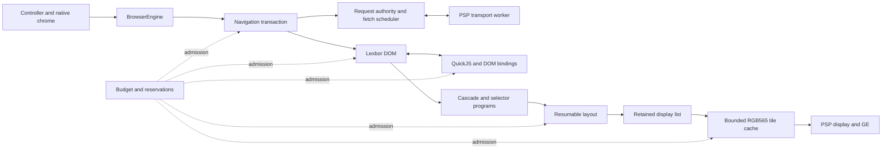
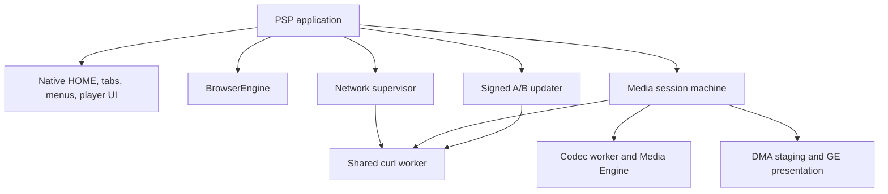
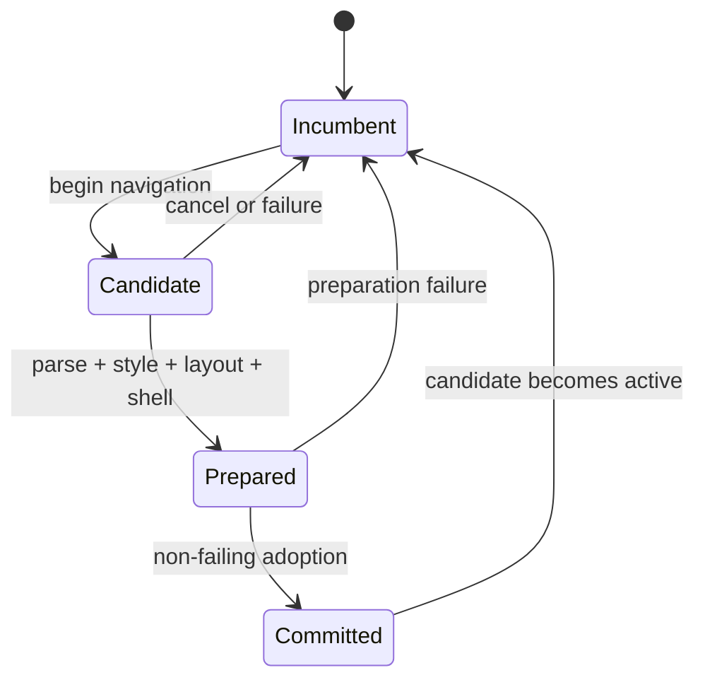
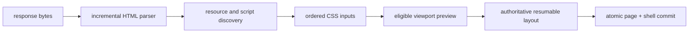

# Architecture

This page is for contributors who need the shape of Tilefinch before changing
it: what owns what, the rules every subsystem keeps, and why. Each section
gives a rule or invariant, the reason it exists, and a link to where the
detail lives. It names only major entry points (a header or a top-level
module) and only the numbers that define behaviour. Mechanism, thresholds,
helper functions, diagnostics, and examples belong in the
[engineering manuals](engineering/README.md) or in code comments, and the page
describes the system as it is, without measurements or history.

Tilefinch is a web browser for the Sony PSP, written in C11. Its target has a
333 MHz single-core MIPS CPU, 64 MiB of RAM, no virtual memory, and a
480×272 RGB565 screen: less memory, in total, than a desktop browser gives a
single tab. On that machine Tilefinch fetches pages over HTTPS and HTTP/2,
parses HTML and CSS, runs JavaScript, lays out modern mobile sites, rasterizes
them into tiles, and plays video through the PSP's Media Engine or a bounded
two-core software decoder.

It aims at the web as it is rather than a curated subset. A modern chat
application loads more than a hundred JavaScript modules, hydrates a
client-side application, and streams its answer into the document. On the PSP
all of that (the DOM, the JavaScript heap, styles, layout, and screen tiles)
has to fit inside a 32 MiB envelope it shares with voice recognition, next to
a TLS stack, a network worker, and whatever the video player is doing.

## What the machine decides

A desktop browser survives a heavy page by having room to spare: swap, spare
cores, a garbage collector that can wait. The PSP has none of that. Running
out of memory is not an edge case to log; it is what an ordinary page does
unless the browser prevents it, and one stalled loop freezes the only core.
So the constraints are the design:

- **One ledger.** Every page-owned byte is admitted through a single memory
  budget, and teardown must hand every byte back.
- **Nothing unbounded.** Every variable-size structure has a fixed maximum
  or an explicit eviction policy, and a refused allocation is an ordinary
  outcome with a rollback path.
- **Everything interruptible.** Parsing, style, layout, script, and network
  work are resumable and cancellable at deterministic points, so the
  controller stays live while a page is heavy.
- **No half-built pages.** A candidate page is assembled beside the current
  one and replaces it only when it is usable.
- **Explicit ownership.** Firmware handles, DMA, transport, and
  browser-thread state each have one owner; other threads publish immutable
  results.
- **Honest evidence.** Host tests, the PPSSPP emulator, and the device prove
  different things, and a pass on one is never taken for another.

The payoff is a browser whose resource policy can be read from the source,
rather than inferred from whether a large machine happened to survive a page.

### Where the memory goes

The PSP process heap does not decide what a page may use. Page and voice work
share one 32 MiB envelope, which is also the `realistic` profile's ceiling;
the 24 MiB `BROWSER_PSP_RECOMMENDED_CONTENT_LIMIT` is only the default for
embedders that call `browser_config_init`. The profiles, the reserve outside
them, and the heap beneath them are in
[PSP envelope](engineering/PSP_ENVELOPE.md#memory-profiles).

### One tap, end to end

Pressing X on a link shows most of the system at once. The native chrome turns
the press into an input event for `BrowserEngine`, the page ownership
boundary. The link starts a navigation transaction: request authority decides
whether and how the fetch may happen, the scheduler hands it to the transport
worker (curl, Mbed TLS, nghttp2), and response bytes come back as immutable
chunks. The incremental HTML parser consumes them while the resource scanner
starts stylesheets and scripts. QuickJS runs the page's scripts against the
Lexbor DOM on the browser thread, the cascade and resumable layout turn the
tree into a retained display list, and a bounded tile cache feeds the PSP's
display and GE. Throughout, every stage is admitted by the budget and can be
paused for input or abandoned if the user cancels; the page that was on
screen stays there until the new one is ready.

## System map

`BrowserEngine` is the page ownership boundary. A frontend submits navigation,
input, and frame work through it and gets back bounded snapshots or borrowed
read-only views. The DOM, runtime, controller, render shell, and allocation
ledger cannot outlive the engine independently.

The PSP frontend adds process services around that boundary:

## The five architectural rules

### 1. One ledger owns page memory

Every page-pipeline allocation goes through `Budget`
(`include/tilefinch/budget.h`): DOM, styles, scripts, resources, layout,
display lists, tiles, session state, and allocator metadata. The PSP profiles
set 16 MiB (`strict`) and 32 MiB (`realistic`, the app's own, shared with
voice) content ceilings. These are admission limits, not estimates of
whatever heap happens to remain.

Budget categories record where memory went; they do not carve out stranded
sub-heaps. Fixed-capacity concurrent pools and inline session tables are
represented by reservations against the same ceiling. Process-lifetime state
that no page can own, such as the CA bundle and the cross-navigation TLS
session store, is bounded separately and counted in the device reserve.

Page JavaScript is layered. QuickJS carves its small objects from its own
arenas, and the QuickJS pool charges only those arenas and the engine's
larger blocks to the Budget as JavaScript memory. A per-object allocator
change therefore belongs in the engine's arena code, not in the pool
([Arenas and the QuickJS pool](engineering/JS_RUNTIME.md#arenas-and-the-quickjs-pool);
[what the page budget counts](engineering/PSP_ENVELOPE.md#what-the-page-budget-counts)).

A refused allocation is a normal result. Parser checkpoints, candidate pages,
layout jobs, cache insertion, and script admission all have rollback or
bounded-degradation paths. Failure injection exercises those paths, and
teardown reconciles the ledger to zero.

The consequence compounds: adding a cache or a Web API is never just another
allocation. It must state its maximum, its accounting category, its lifetime,
and what still works when admission fails.

### 2. The browser graph has one mutation owner

Only the browser thread mutates the DOM, JavaScript, style, layout, history,
cookies, cache policy, and UI state. The object graph therefore needs no
locks, and a cancellation checkpoint is a trustworthy transaction boundary.

Other threads exist only where the platform can block or where hardware
genuinely runs concurrently:

| Worker | Owns | Publishes |
|---|---|---|
| transport | curl handles and fixed response buffers | immutable response chunks and terminal status |
| raster decode | one browser-admitted JPEG arena | generation-tagged RGBA completion |
| codec | one prepared firmware job at a time | decoded audio or a generation-tagged video surface |
| DMA | framebuffer staging transfer | completion for the exact slot generation |
| audio | PSP audio submission | consumed PCM position |
| voice | optional recognizer job | bounded recognition result |
| microphone | one `sceAudioInput` transfer pair while a page captures | samples into a fixed single-producer ring; an atomic level and run state |
| clock/watchdog | platform timing or liveness observation | atomics and fixed records |

These are operating-system threads. A page's Web Workers are not: each
dedicated worker is another QuickJS context on the browser thread (see
[Realms, workers, and frames](#realms-workers-and-frames)), so creating one
adds a realm, never a second mutator.

Workers never walk the DOM, call page allocators, update chrome, or write
profile state. Cross-thread messages use bounded slots, generation tokens, and
release/acquire publication. Thread priorities are declared together in
`include/tilefinch/psp_threads.h`, so their ordering can be reviewed as one
system. JPEG entropy decoding, for example, runs below browser priority;
cancelling it invalidates its token without waiting, and only the browser
thread may adopt the finished pixels or trigger the resulting relayout.

The rule is enforced, not only described. The `Budget` intrusive list is
deliberately unlocked, so a build with `TILEFINCH_OWNER_CHECKS` binds each
ledger to the first thread that mutates it and reports any other thread that
allocates, frees, reserves, or reallocates through it; a worker reaching into
page state is caught at the allocation, not later through a corrupted list.
A worker that needs page-charged memory uses a `BudgetConcurrentPool`, and an
intentional handoff adopts the ledger explicitly. Host test builds check by
default, and a violation aborts the test; on the PSP only a qualification build
opts in, because a thread-identity syscall on every allocation would distort
the timing validation builds measure.

The loading-UI supervisor is the case the check exists for: it draws chrome
from the firmware callback thread while a load or a media open runs, from a
private copy of the UI state, and never reads the engine. One presentation
fence orders it against the browser thread: a modal loop holds the fence for
its life, and every write to data the copy borrows holds it for the store
alone, with Memory Stick I/O outside it
([UI during page work](engineering/UI_DURING_PAGE_WORK.md#the-loading-ui-supervisor)).

### 3. Commit complete state, never partial state

Navigation is an incumbent/candidate transaction:

The incumbent page stays renderable while the candidate receives bytes,
parses, resolves resources, runs admitted blocking scripts, and builds its
authoritative layout. Before the old graph is destroyed, the candidate also
prepares its controller and tile shell. The final adoption only moves state
that is already owned, so it cannot allocate.

Reader presentation rides the same transaction: after admitted scripts
settle, one bounded content-shape pass classifies the page and installs a
hidden semantic extraction beside the untouched raw DOM, and Reader CSS
switches between the two without reparsing, keeping the nearest reading
position. When Reader is already active, this happens before the candidate's
first authoritative layout, so the page is not laid out twice
([Reader mode](READER_MODE.md)).

A navigation failure leaves the incumbent usable and opens a bounded recovery
surface over it (retry, Reader retry, and only the context actions that can
help); Return simply shows the incumbent again, and no action publishes half
a candidate with stale controller or render state.

### 4. Work is budgeted in time as well as bytes

Parsing, selector matching, scripting, layout, resource decoding, tile
rasterization, screenshots, offline saves, and installation all run as
bounded pumps. The main loop spends a quota, presents progress the user can
see, and resumes from an owned continuation. A pending navigation pumps again
within a frame while each pump makes progress of its own, for at most a 12 ms
slice, so the frame still ends in its vblank wait and the lower-priority I/O
threads keep the rest of the interval. Parser-blocking classic scripts are
the bounded exception: they stay synchronous, with cooperative checkpoints,
inside the limits described in [Script admission](#script-admission).

#### Optional pumps are admitted by one declared table

The pipeline stages of a frame (input, navigation, runtime, media, raster,
present) have fixed positions in the PSP resident loop. The optional work
between them (preconnect, update installation, screenshots, offline downloads,
site-data restoration, provider pre-resolution, page idle work, deferred
images, and baseline fonts) has no private predicate at each call site, apart
from two declared site-data restoration sites (the navigation gate and exit
cleanup) named in `include/tilefinch/frame_pumps.h`. It is admitted by one
constant policy table in `src/frame_pumps.c`, whose entries are in loop order
and state which frame facts refuse a pump, which pumps it yields to, and which
contended resources (the Memory Stick, a long idle slice) one of its slices
claims.

- *Readiness* ("do I have work?") stays with the pump's owner and is read at
  the moment of admission.
- *Admission* ("may I run, given everything else?") is answered only by
  `frame_pumps_admit()`, from facts sampled just before asking.

The loop is single-threaded, so pumps never race, but they do contend: as a
rule a frame performs at most one long idle slice and one optional Memory
Stick operation. `tests/test_frame_pumps.c` enumerates every workload against
every distinct refusal set and pins, each with a written reason, the pump
pairs that can still claim one resource in a frame, so a new pump, a dropped
yield, or a new resource claim fails until the author decides the overlap.
`include/tilefinch/frame_pumps.h` records each decision.

#### Resumable jobs

The authoritative layout is a `LayoutBuildJob` with explicit phases: flow,
compaction, visibility and focus, paint order, spatial indexing, scroll
metadata, and finalization. Partial display lists stay private to the job
until `layout_build_job_take()` publishes a complete result. Container
queries get at most one measured probe followed by one authoritative rebuild,
and the rebuild is skipped only when every answer the probe logged still
holds against the measured geometry
([container queries](engineering/STYLE_INVALIDATION.md#container-queries)).

#### Input during long scripts

Post-load runtime work on the PSP arms a cooperative UI scope on the owner
thread. Once a task has run for 8 ms, a checkpoint keeps the last completed
frame, samples input at most every 16 ms, queues direction and activation
presses with visible feedback for replay when the task returns, and lets
Circle request cancellation. No controller or DOM action runs inside a
suspended mutation, and no framebuffer changes hands. This is cooperation,
not preemption: a native call with no checkpoints still blocks feedback, and
a queued press alone is not a time-to-interactive pass
([UI during page work](engineering/UI_DURING_PAGE_WORK.md#owner-thread-cooperative-scope)).

#### Fast paths

PSP-specific fast paths (32-bit and fixed-point arithmetic, interned selector
programs, viewport-limited preview layout, paint-only image publication, and
bounded caches for repeated work) never change results; they are listed with
the [32-bit hot-path discipline](engineering/PSP_ENVELOPE.md#fast-paths).

### 5. Host determinism and device truth are separate gates

The host and the PSP run the same retained display list and software raster
primitives. RGB565 conversion uses coordinate-stable ordered dithering, so a
pixel does not depend on traversal order. The host lab can therefore compare
the engine against a 480×272 Chrome reference while unit tests pin exact
layout, counter, and raster behavior.

That does not make host timing a prediction of PSP timing. The host proves
logic, rollback, bounds, and visual output. PPSSPP proves the Allegrex build
and many PSP ABI paths. Only hardware proves cache coherency, module
availability, WLAN timing, Media Engine behavior, Memory Stick semantics, and
real input latency. [Device qualification](engineering/DEVICE_QUALIFICATION.md)
assigns each claim to the environment able to prove it, and the
[evidence gates](DEVELOPMENT.md#evidence-gates) say what each gate proves and
how performance is judged.

A *validation build* in these documents is a PSP build configured with
`TILEFINCH_PSP_VALIDATION_LOG=ON` (the `build-preset-psp-validation` tree);
the separate `psp-validation/` EBOOT is unrelated
([presets and build trees](DEVELOPMENT.md#presets-and-build-trees)).

## Navigation and first paint

A document is not downloaded and then parsed. A navigation advances a bounded
pipeline:

The resource scanner starts stylesheets and eligible scripts while later HTML
is still arriving. A preview paint is attempted only when the parsed prefix
can produce visible pixels: eligible pages can paint before parser-blocking
scripts run, while pages that depend on scripts keep the correct blocking
order. A stylesheet cut at its per-file cap keeps only its complete top-level
rules, so no half rule is applied
([stylesheet input](engineering/STYLE_INVALIDATION.md#stylesheet-input)).

The fetch scheduler caps active page slots, response bytes, callback work,
and elapsed pump time, and it pauses curl delivery when its bounded handoff
buffer is full. The candidate owns every continuation, so replacing or
cancelling it retires the whole pipeline without a callback reaching the next
page. The parser, provisional layouts, and finalization are in
[Streaming navigation](engineering/STREAMING_NAVIGATION.md).

### Declarative refresh

`<meta http-equiv="refresh">` and the `Refresh` response header follow the
HTML Standard's shared declarative refresh steps, with or without JavaScript.
Only a document's first refresh counts. Its timer runs on the page clock from
the first runtime advance after commit, so it pauses whenever page work does,
and a due refresh is followed like a page-script navigation that replaces the
current history entry. Any other navigation, unloading the page, or the user
editing a field cancels it, and a refresh in a child frame does nothing, so
no frame can move the top-level page.

Two rules keep a refresh from taking the page away from the user. At most
`NAVIGATION_REFRESH_CHAIN_LIMIT` (5) consecutive refreshes run with no user
input. A same-URL refresh after any button press since load becomes an offer
the user takes with Square, because a reload would discard the page someone
is reading. Which refresh counts, the PSP handoff, and the status lines are in
[Page-initiated navigations](engineering/PAGE_NAVIGATIONS.md#declarative-refresh).

### Script navigations and history

A top-level navigation requested by page script keeps or replaces the current
history entry as the HTML Standard's history handling says.
`location.replace()` replaces it, so back skips the page that redirected;
`location.assign()`, assigning to `location`, and following a link push a
new entry; `location.reload()`, a fragment-only `replace()`, and
`history.replaceState()` keep the entry they are on
([script navigations](engineering/PAGE_NAVIGATIONS.md#script-navigations-and-history)).

## JavaScript

QuickJS runs every page script on the browser thread, within a page-specific
heap limit and the shared page budget. The sections below follow a script's
path: the platform bootstrap every realm starts from; the realms a page can
own and the one scheduler that runs their tasks; how platform objects and DOM
nodes keep their identity; the vendored engine; and how page scripts,
webpack bundles, and WebAssembly are admitted. The mechanism behind each is
in [JavaScript runtime](engineering/JS_RUNTIME.md) and
[Script memory](engineering/SCRIPT_MEMORY.md).

### Bootstrap without spending the realm at startup

The platform bootstrap is generated as uncompressed QuickJS bytecode and
restored directly from read-only program data, with no per-navigation inflate
buffer or duplicate copy. Features are split into modules that activate
lazily within fixed bounds: core DOM and event semantics are available
immediately, and larger facilities install when a page first reaches their
surface (the `Intl` polyfill, for example, on first access to `Intl`). The
committed bytecode carries no source text or debug tables, which every realm
would otherwise copy, and a generated manifest proves it matches the authored
sources ([regenerating the bootstrap](../src/bootstrap/README.md#regenerating)).

### Realms, workers, and frames

Every script realm a page owns runs on the browser thread, so none adds a
mutator. A page can own three kinds of realm; the last row is the
`SharedWorker` shell, which creates none:

| Realm | Bound | Isolation | Communicates by |
|---|---|---|---|
| same-origin nested frame | 16 contexts per parent runtime | a QuickJS context sharing the parent's heap and `Budget` | direct object access, as the platform requires |
| dedicated Web Worker | 4 contexts per page runtime | its own context and global; structured clone across the boundary | messages queued as platform tasks |
| loaded child document (`<iframe>` navigation) | 4 per page | its own `ScriptRuntime`, document, and image set | a generation-tagged, sequence-numbered message queue pumped by the owner |
| shared worker | none: `SharedWorker` is a constructor shell that creates no realm | — | — (construction throws `NotSupportedError`) |

A Web Worker is concurrency in the page's programming model, not in the
engine: its messages cross a structured-clone boundary and run as tasks of
the single event loop. A loaded child document is its own document, shown in
its parent only as an opaque pixel snapshot, so the parent never reads the
child's DOM. A same-origin frame's WindowProxy and realm are created only
when script reads them, so frames no script touches cost no realm.
`SharedWorker` exists only so feature detection sees a current browser
([shared workers](engineering/JS_RUNTIME.md#shared-workers)).

Frames and workers share one retirement boundary: eviction or termination
retires the realm before releasing its native reference, so retained
functions keep their storage alive but cannot run
([realms](engineering/JS_RUNTIME.md#realms)).

### Tasks, timers, and activation

One scheduler owns every queued callback: timers run the HTML timer
algorithm, platform tasks share its bounded queue without entering that
algorithm, and the page clock follows wall time
([scheduler and page clock](engineering/JS_RUNTIME.md#scheduler-and-page-clock)).

Page input events describe the press the user made, in browser order, and are
all trusted. X on a highlighted element is the Enter key of a TV or console
browser, key events around a keyboard-style `click`; X with the analog cursor
showing is a mouse button; on-screen keyboard text arrives as one
composition, as a phone keyboard's does
([input events](engineering/JS_RUNTIME.md#input-events)).

User activation is a timed realm state, not a flag held during one dispatch;
activation-gated native operations ask the realm, and a script-initiated
navigation snapshots it when requested
([user activation](engineering/JS_RUNTIME.md#user-activation)).

### Platform objects keep private identity

Platform interfaces are ordinary bootstrap JavaScript, so their brand must not
be forgeable or breakable from the page. The convention is uniform:

- instance state lives in a closure-held `WeakMap` captured before author code
  runs, or an owner-held private field when the state refers back to its owner;
  never in `_underscore` properties;
- constructors reject everything but a private token;
- receiver checks compare against that captured identity, not `instanceof` or
  a mutable global such as `window.navigator`.

A page that replaces `navigator`, poisons a prototype, or calls an accessor on
a look-alike gets the `TypeError` a browser would raise and cannot disturb the
real object. Native handoffs follow the same rule: the host captures what a
lazy module needs before author code runs and passes it through a temporary
global that is deleted immediately, and `Event.isTrusted` is a
non-configurable own accessor backed by the same private state. New Web API
surface is expected to follow this pattern.

Web IDL receiver checks are one engine mechanism, not code per member. Before
any page script, the host marks every interface prototype on the global and
its member functions, and calling a marked member with a receiver that has no
interface prototype on its chain throws "Illegal invocation" before the
member runs. A lazy module's interfaces are marked when it loads, and only
what the module itself defined, so what a page adds to an interface is never
marked ([receiver checks](engineering/JS_RUNTIME.md#web-idl-receiver-checks)).

WeakMap values must not retain their own keys, because this collector cannot
reclaim that ephemeron cycle; state that refers back to its owner lives in a
private field on the owner
([WeakMap cycles](engineering/JS_RUNTIME.md#weakmap-cycles-and-namespace-mirrors)).

### Interface snapshot

The bootstrap shares its realm with page scripts, and a page may replace
any built-in: `Array.prototype.push`, the array iterator's `next`,
`Map.prototype.get`, `Function.prototype.call`, `Object.keys`,
`Element.prototype.remove`. The bootstrap calls these at run time. It is
kept apart from the page's changes by the engine, not by how its source is
written.

When a realm's start-up script ends, the engine marks the interfaces as
they are: the class prototypes, the functions the global object holds with
their prototypes and methods, and the namespace objects. Marking sets one
bit per object and allocates nothing. The rules that follow from it:

- **Copy on the page's first change.** The first change page code makes to
  a marked object copies that object's own properties and prototype to a
  private twin. The page keeps the object it changed; browser code
  continues its lookups in the twin.
- **A member the page changed stays the page's.** A later change by browser
  code (a lazy module adding members) reaches the object and its twin,
  except for a member the page has changed since: that change is made in
  the twin alone.
- **Pinned global bindings.** Page code that names, assigns, declares,
  redefines or deletes a global holding an object gets a variable reference
  of its own; bootstrap functions keep theirs. A later browser change to a
  global the page changed is made in the browser's view alone, and a
  browser script after the snapshot declares no global.
- **Platform members are not shadowed.** A function the page puts on an
  instance or defines in a subclass does not stand in for a member the
  browser defined further up the prototype chain when browser code reads
  it.
- **Steered writes.** A change browser code makes to an ECMAScript
  prototype is the browser's own only while a module loads or outside any
  script; any other is copied on like a page's.

Twins and the page's own variable references are page heap, charged like
any other object; a refused one fails the page's write with an ordinary
out-of-memory exception. `boot.cfg`'s `interface_snapshot=0` builds realms
without the snapshot, for comparing the two on one binary. Whose code is
running, what the snapshot does not cover, the test seam and the tests are
in [Interface snapshot](engineering/JS_RUNTIME.md#interface-snapshot).

### DOM node handles

Script reaches native nodes through a bounded handle table: a handle is a
slot number plus a generation, so a slot can be reused after its node is
destroyed or its detached wrapper is collected without an old wrapper ever
naming the new node. A live connected node keeps its slot even without a
wrapper, because bootstrap state (listeners, observers) is keyed by handle.
Growth is Budget-admitted like any page allocation, and a refusal is the same
clean `RangeError` a full table reports
([table sizes](engineering/JS_RUNTIME.md#dom-handle-table)).

### Computed style is one generated registry

`getComputedStyle()` reports resolved values for the properties the engine
supports, and only those: a disconnected element has an empty declaration
block, and an unsupported name is absent rather than answered from a table of
initial values. A single X-macro list, `COMPUTED_STYLE_PROPERTIES` in
`src/js_computed_style.c`, generates the property table, the identifiers the
getter dispatches on, and per-row flags, so no value can resolve for an
unlisted property. Values are serialized from the resolved style, never from
authored text, so what script reads is what is painted. Resolved styles are
retained between reads, and every change that can alter a cascade drops what
it can reach
([retention](engineering/JS_RUNTIME.md#computed-style-retention)).

### QuickJS is vendored and changed in place

QuickJS lives in `third_party/quickjs` with Tilefinch's changes already
applied. `cmake/TilefinchDependencies.cmake` pins the SHA-256 of `quickjs.c`
and `quickjs.h`, and a mismatch fails configure, so an engine change is an
ordinary reviewed diff plus a pin update. The patch files under `patches/`
are inputs only for lab variants, which rebuild a copy of the engine in the
build directory with their own pinned fingerprints.
`third_party/quickjs/README.md` lists every carried change in application
order.

Most of the changes serve the memory ceiling: bounded array growth that
collects near the limit instead of refusing, collection opportunities at
allocation sites upstream never checks, interruptible compilation, Latin-1
string storage, and in-place appends to a sole-owned string, so the `s += x`
loops common in minified decoders amortize instead of copying.

Two changes shape how page code is held. Long functions compile on their first
call, but a validating preparser still checks every body at load, so a script
with a syntax error anywhere is rejected before any of it runs
([lazy functions](engineering/JS_RUNTIME.md#lazy-functions)). Dense arrays of
small values are stored packed, invisibly to the language
([compact arrays](engineering/JS_RUNTIME.md#compact-arrays)). The PSP build
favours the engine's speed over its size and trains it with profile-guided
optimization for releases
([engine representations](engineering/JS_RUNTIME.md#engine-representations)).

### Script admission

Page scripts are admitted by source size, count, heap, time, and callback
work, and interrupt checks cover QuickJS execution and native callback
boundaries. The PSP app admits a script by the memory its compile needs
rather than by its size (`include/tilefinch/script_admission.h`).

- **Blocking scripts stay synchronous.** Parser-blocking classic scripts run
  synchronously and in source order within the realm's finite source
  allowance: bounded synchronous execution with cooperative checkpoints, not
  resumable evaluation or a worker thread.
- **Size is not suspicion.** Size, loops, or dynamic-code tokens alone never
  refuse a script; per-file and count limits, memory admission, the shared
  heap, and the compile/execution watchdog decide.
- **A compile that cannot fit is refused before it runs.** Every compile is
  admitted against the heap it can really reach, and an inline script is
  checked as its text streams, so a doomed script never costs a compile.
- **Source exists once.** Parsed script text compiles in place from the DOM,
  and large raw text is handed to the document rather than copied.
- **Data, not code.** Inert JSON script types stay DOM data, and a narrow
  subset of classic scripts that only assign strict JSON installs its data
  without compiling bytecode.
- **No `nomodule` fallback.** Because the engine supports modules, classic
  `nomodule` scripts never run, and a module failure never enables the legacy
  alternative.
- **Hydration rollback.** If later hydration fails or runs out of quota and
  collapses the body, commit restores one complete, visibly useful snapshot
  taken before the first parser-blocking author callback.
- **Circuit breaker.** One navigation's parser stage may spend at most the
  realm's source allowance, twenty seconds across its blocking checkpoints,
  or three consecutive scripts that fail in a way that says the realm is in
  trouble; a script's own exception is not such a failure. When a bound
  trips, the remaining blocking scripts are skipped, parsing continues, the
  page is marked Limited, and the author realm is retired for that document
  ([circuit breaker](engineering/SCRIPT_MEMORY.md#circuit-breaker)).

Compiled scripts are reused, never trusted: bytecode is keyed by the
response, the top-level site, compile options, and the digest of the exact
source, and is consulted only after every fetch check
([compiled-script reuse](engineering/SCRIPT_MEMORY.md#compiled-script-reuse)).
Each rule's thresholds and diagnostics are in
[Script memory](engineering/SCRIPT_MEMORY.md#admission).

### Lazy webpack bundles

A classic script shaped like a webpack chunk registration is not compiled
whole. A bounded planner finds its factories, registration keeps each one's
exact source compressed, and a factory is compiled the first time it runs, so
the many factories a page never runs cost no compile. Anything the planner
does not take goes through the ordinary eager path.

This is a deliberate deviation: a factory's syntax is checked when it first
runs, not at load, so an error in a factory that never runs is never
reported, where Chrome would reject the whole file. Checking every factory up
front is most of a lazy bundle's load cost, a bundle that does not parse is
broken in every browser, and a plan that does not cover the whole
registration takes the eager path
([lazy webpack bundles](engineering/SCRIPT_MEMORY.md#lazy-webpack-bundles)).

### Function source outside the heap

QuickJS keeps every function's source text for
`Function.prototype.toString()` and for lazy first-call compiles, which for a
large classic script is a second copy of the script in the realm heap. Large
classic scripts therefore compile without it, and their text lives in a
function-source store in the page Budget, counted as JavaScript memory: plain
while the page has room, compressed and then dropped under pressure. The
store is never the reason a page runs out of memory, text an uncompiled lazy
function needs is never dropped, and admission counts stored text as if it
were in the heap, so a page admits the same scripts either way
([function-source store](engineering/SCRIPT_MEMORY.md#function-source-outside-the-heap);
[store rules](engineering/SCRIPT_MEMORY.md#store-rules)).

### WebAssembly

Small WebAssembly modules use the standard JavaScript API through the
[bounded WebAssembly profile](WEBASSEMBLY.md). Host labs link the pinned
interpreter directly; the PSP EBOOT keeps only a versioned adapter and loads
the interpreter lazily from the active signed slot on first namespace access.
The module, runtime pool, memory, imports, exports, stack, and native
instruction work all have fixed ceilings. Unsupported proposals and import
kinds fail through the API without weakening the page's Budget, origin, CSP,
or transport policy.

## DOM mutations and style invalidation

DOM mutations are journaled and coalesced before they trigger style and
layout. The journal is bounded per turn; when it fills, the engine restyles
the few subtree roots that hold the unrecorded changes, and falls back to a
full reset only when a root cannot be named.

Invalidation is scoped by what the sheet's rules can read: a change restyles
the elements whose matching it can alter (siblings and `:has()` anchors
included) and nothing else, and a journal whose every change stays inside
content that renders nothing skips the relayout altogether. Retained computed
styles live in a table that grows to cover a whole document-order walk,
because a smaller LRU table evicts each entry before the next build reaches
it. Each scoping rule and its exclusions are in
[Style invalidation](engineering/STYLE_INVALIDATION.md).

## Rendering and presentation

Layout produces a retained display list of text, fills, borders, images,
stacking contexts, transforms, clipping, fixed and sticky geometry, and focus
metadata. The renderer rasterizes 128×128 RGB565 tiles on demand and keeps a
bounded spatial index, so scrolling costs work in proportion to the visible
content, not the document's length.

Unsupported motion resolves to one coherent static presentation: final
visibility and opacity are kept, scroll-linked transforms flatten, and
synthetic spacer scenes are contained. Layout records the first coordinate
clamp and confines a saturated non-root subtree, so the coordinate sentinel
cannot blank every later scroll viewport.

Mixed-direction page text is a sparse extension of the same retained layout,
not a second document representation. Ordinary left-to-right paragraphs
bypass it; admitted right-to-left paragraphs keep their logical DOM text while
a bounded UAX #9 analysis produces levels, contextual forms, shaped advances,
visual line order, and logical-to-visual glyph sidecars that painting, links,
controls, focus, and find all share
([Bidirectional page text](TEXT_BIDI.md)).

Simple focus changes recolor a ring reserved in retained paint instead of
laying the page out, within a fixed number of slots and with layer order and
geometry fixed; anything else falls back to authoritative layout
([retained focus paint](engineering/STYLE_INVALIDATION.md#retained-focus-paint)).

Web content and native chrome are separate layers. The browser frame stays
stable while menus, find, the keyboard, loading status, and player controls
animate over it. Mode-specific painters are deliberately out of line, so the
per-frame browser and media compositors stay small enough for the Allegrex
instruction cache; the ELF build ratchets those hot symbols separately from
total `.text`. Fullscreen video keeps the decoder's 8888 scanout and composes
the player's overlay only inside bounded rectangles
([Media pipeline](engineering/MEDIA_PIPELINE.md#psp-decode-and-presentation)).

Images are decoded without forced-dark color inversion. Dark mode transforms
authored foreground and background colors at paint boundaries, while
photographs, thumbnails, and decoded video keep their source colors.

Games and interactive pages use the four bounded native surfaces below. Their
author-facing limits are in the [Game Profile](GAME_PROFILE.md) and the
[WebGL guide](WEBGL.md).

### Canvas 2D

Canvas 2D keeps two copies on purpose: an exact, lazily allocated RGBA backing
array inside the page's QuickJS budget, and at most four budget-owned native
snapshots. The JavaScript array is the exact mutable state that
`getImageData()`, export, and canvas-to-canvas drawing require; the native
snapshot is a stable presentation generation the renderer may read while
author code keeps changing the canvas. Removing either copy without first
moving exact readback and generation ownership into a native surface would
trade memory for stale-frame races or visible pixel changes.

The native raster seam draws real Tilefinch glyphs, coverage-antialiased
paths, gradients, and transformed sprites under bounded clips, and degrades
complex shadows to one offset sample so blur work never grows with page
input. Drawing crosses into native code in bounded batches, and all drawing
in a turn coalesces into one dirty rectangle whose rows are copied into the
snapshot, invalidating only the affected tiles, so a same-size animation
rebuilds no style, layout, or display list. Animation frames and Page
Visibility follow the presented screen
([animation frames](engineering/JS_RUNTIME.md#animation-frames-and-visibility)).
Authored dimensions are scaled down to the
PSP surface envelope, and deep clip stacks or excess raster work fail softly
while the rest of the page stays usable.

### Gamepad and fullscreen

The Gamepad API exposes one standard-mapped controller for the built-in PSP
controls. It stays disconnected until the user holds Start+Select or a
trusted Play click calls `navigator.tilefinch.requestPageControls()`, which
shows a native exit notice and suppresses the activating face button until it
is released. Native input authority is a small, generation-bearing capture
record: navigation, native media, or suspend disconnects the controller and
returns control to the browser, and cross-origin child frames never receive
the snapshot. The held chord always returns control, and the firmware HOME
callback sits outside page capture. Polling reuses the button and axis
objects ([gamepad polling](engineering/JS_RUNTIME.md#gamepad-polling)).

The page Fullscreen API is a single top-level presentation state. A trusted
activation commits the element's identity before native chrome is hidden;
Triangle or Start+Select exits immediately, and navigation or node retirement
clears the borrowed handle. The PSP has no separate compositor top layer, so
style resolution gives the active element a fixed viewport-sized box and
supports `:fullscreen` without adding a spoofable DOM attribute.

### WebGL

WebGL 1 is a lazy, bounded command translator over the PSP graphics engine
(GE), not a software GLSL interpreter. The JavaScript layer admits only shader
shapes the GE's fixed-function pipeline can run and snapshots each draw's
state into a bounded, versioned command batch that the native side validates
again before the GE sees it, so malformed geometry or unsupported state is an
ordinary WebGL error or context loss while the document stays usable. Every
WebGL resource has a fixed per-realm ceiling, all page-owned graphics memory
is charged through `Budget`, and the GE's EDRAM targets and command ownership
are shared with the media presenter rather than adding a second graphics
authority. GE synchronization is the ownership boundary before CPU readback,
and the drawing buffer is opaque because the GE's alpha channel doubles as its
stencil plane. The [WebGL guide](WEBGL.md#how-the-psp-path-is-built) has the
translator, publication paths, and probes.

### Game audio

Game audio is another lazy, bounded module, not a second media player. One
`AudioContext` decodes a few PCM WAV buffers into a fixed native pool and
mixes a few voices, including generated oscillators, on a PSP audio worker.
Parameter changes publish packed atomic coefficients that the worker samples
once per mixer block, start and stop times use a wrapping 32-bit
output-frame clock, and no synthesis path allocates or does floating-point
work on the audio thread.

The context starts suspended and resumes only on trusted activation. Suspend
and native page media release the scarce PSP audio channel while keeping
decoded effects, so game sounds cannot take the video player's channel. A
finished voice keeps its generation-bearing slot until the browser thread
takes its completion notice and dispatches `ended`, so worker code never
enters JavaScript and a late completion cannot target a newer sound.
Compressed formats, custom graphs, long-horizon scheduling, and PCM readback
fail explicitly.

## Request authority, transport, and cache provenance

Every page-originated request crosses one construction boundary. Callers
supply a typed `TilefinchRequestContext`, and
`fetch_prepare_page_request_context()` derives cookies, Origin, Referer, Fetch
Metadata, credentials, CORS, CSP, mixed-content and Private Network Access
policy, content blocking, and cache-partition authority. Validation rejects
page requests that bypass that preparation marker.

Response security fields are parsed once, while the complete wire headers are
available, into typed metadata, so CORS, CORP, CSP, HSTS, nosniff, frame
policy, and referrer-policy consumers never reinterpret a truncated generic
header snapshot. Resource-cache entries carry their partition and
authorization grant, and entries that carry authority stay in memory rather
than being serialized as generic cache records.

On the PSP, one shared transport worker owns curl, with lazily grown response
lanes, two larger media range windows, and one bodyless HOME preconnect
descriptor. Redirects stay singular: the browser authorizes one hop, the
worker executes it, and the next hop starts only after the browser accepts
the result, while independent requests and HTTP/2 multiplexing still run
concurrently.

An authoritative navigation supersedes its incumbent page's unfinished
optional network work before queuing the candidate document, so thumbnails,
fonts, scripts, and page fetches cannot hold every worker descriptor ahead of
the link the user just activated. The incumbent DOM and last frame stay intact
for rollback, but superseded requests are not restarted if the candidate
fails: a deliberate responsiveness tradeoff while the transport has no
separate authoritative-priority lane.

The release owns its curl, Mbed TLS, and nghttp2 chain. Archives are
digest-pinned, runtime provenance is checked, HTTP/2 is negotiated through
ALPN with HTTP/1.1 fallback, and HTTP/3 is out of scope. TLS sessions are
kept by default in a bounded, checksummed, same-site store cleared with cache
data; a preference disables keeping them across boots without disabling
reuse within a process.

WebSockets reuse the same curl worker, TLS state, cookie authority, and
`connect-src`, mixed-content, and Private Network Access decisions instead of
a second network stack. A socket holds one bounded receive message and bounded
outbound data, a single published receive event provides backpressure, and
all of it is charged to the page `Budget`. Only the Allegrex build ships
curl's WS/WSS framing; the host tests the JavaScript lifecycle through an
injectable seam and the worker's WebSocket code over loopback.

Installed offline games have a separate, explicitly user-activated direct
multiplayer lane, resembling the message portion of `RTCDataChannel`. The PSP
worker owns DNS and UDP behind fixed command and event rings, and one
session, small datagrams, and fixed deadlines keep it inside the page
`Budget` and the network supervisor. Ordinary pages cannot open it, launching
an offline app does not request Wi-Fi, leaving the document cancels the
worker and its lease, and there is no relay or general page UDP API ([Direct multiplayer](MULTIPLAYER.md)).

### Provider caches

The native YouTube provider keeps a few generated pages and parsed watch
facts in short-lived, optional session caches keyed by URL, presentation, and
cookie authority. Reclaim and every clear action drop them, raw responses are
never kept, and jobs copy facts rather than borrowing an entry across a pump
([Media pipeline](engineering/MEDIA_PIPELINE.md#provider-caches)).

[PSP transport](engineering/PSP_TRANSPORT.md) and the
[security model](SECURITY_MODEL.md) define the exact protocol and policy
boundaries.

## Explicit lifecycle machines

The two device subsystems with the most dangerous teardown ordering are
driven by pure, host-testable reducers.

### Network supervisor

The network supervisor reconciles demand (`off`, `ready(profile)`, suspend)
with the PSP's physical network state. Its inner APCTL and module ladder is
pumped rather than hidden inside a blocking effect. Consumers hold
generation-bearing transport leases. Network teardown closes admission, drains
the leases, leaves APCTL, then unwinds the owned rungs in reverse order.

A timeout never unloads the stack beneath a worker still executing inside it;
the stack is kept, with an explicit wedge obligation, until the lease retires.
Link errors are treated as hints and followed by an APCTL probe, so an HTTP
error or a CDN rate limit cannot spuriously restart networking. The full state
and event contract is in
[PSP network supervisor](engineering/PSP_NETWORK_SUPERVISOR.md).

`Ready` means the PSP stack is associated and has an address, not that the
access network grants Internet service. Captive-portal discovery is a
separate, user-initiated frontend operation that adds no portal guessing to
the network reducer and never relaxes TLS globally
([captive-portal sign-in](SECURITY_MODEL.md#captive-portal-sign-in)).

### Media session

The media controller distinguishes opening, priming, playing, paused,
buffering, seeking, recovery, dormancy, quiescence, suspend, and failure.
Transitions produce commands; codec drain, DMA join, transport cancellation,
and pipeline release return completion events. No state that owns a pipeline
can jump directly to a resource-free terminal state.

The player has one packet pipeline, whatever the source. Provider streams,
offline downloads, and compatible page `<video>` and `<audio>` elements each
keep their response authority and feed the same decoder, buffering, clock, and
presentation services, and media bytes stay in RAM. The stream's actual SPS
picks the decoder before any is built: the firmware bridge for Baseline and
Main within PSP bounds, an optional user-built software decoder for compatible
High-profile streams and for Baseline/Main streams the firmware would refuse
([Route selection](engineering/MEDIA_PIPELINE.md#route-selection)).
Presentation follows media timestamps and records claimed, staged, and
displayed identities instead of treating an attempted present as success.

The control contract is in
[PSP media session](engineering/PSP_MEDIA_SESSION_STATE.md); sources, decoder
choice, the software decoder, page-data discovery, and the host and device
seams are in the [Media pipeline](engineering/MEDIA_PIPELINE.md).

## PSP frontend ownership

The frontend separates ownership from control:

| Structure | Contains | Must not contain |
|---|---|---|
| `PspProcessResources` | paths, boot configuration, native presentation, text input, clock ownership | media/network policy |
| `PspBrowserResources` | engine-lifetime handles and service objects | duplicate lifecycle authority |
| `PspInteractiveState` | one loop invocation's input, recovery, and validation records | resource ownership decisions |
| `PspEngineViews` | one refreshed snapshot of borrowed engine state | independently refreshed aliases |
| `PspExitPlan` | tagged reason and handoff | teardown obligations |
| `PspShutdownReport` | independent retained/quarantined obligations | user intent |

`psp_app_run_interactive()` is the resident loop: a cold driver that sets up
the loop state, calls `psp_loop_frame()` once per frame, and tears down. A
frame is a fixed sequence of steps whose order is load-bearing (frame pumps
admit work by position). Work a frame does not always do lives in named steps
behind the check that guards it; steps a page or media frame runs every time
are hot boundaries measured together by the build (see
[the PSP envelope](engineering/PSP_ENVELOPE.md)), so a new feature that runs
every frame joins those sets, and one that does not becomes a step behind its
own check. `psp_browser_close()` first drives the media and network machines
to safe terminal states, then frees only the resources their reports mark
releasable. Owners release resources; machines decide when release is safe.

### Boot and HOME

HOME and Collections are native chrome, not hidden HTML documents, so they
render from bounded profile snapshots before networking starts. The native
HOME placeholder owns neither an unused QuickJS realm nor an HTTP worker.
Wi-Fi warm-up, secure entropy, the TLS-session store, the trust bundle, the
shared HTTP worker, the remaining baseline fonts, and site-data restoration
are prepared after HOME's first paint, in separate units that yield to input
and navigation; none is a prerequisite for showing HOME or taking its first
input, and activating a tile acknowledges the press before any of them
finishes. The ordering, the font staging, and the boot timeline are in
[PSP envelope](engineering/PSP_ENVELOPE.md#boot-order).

Five tabs keep navigation, scroll, focus, find, and thumbnail facts, but only
one engine page graph is live. Optional tab hibernation and session restore
serialize bounded navigation facts, never a DOM or JavaScript heap.

## Storage and updates

Normal frame, input, style, layout, raster, and playback paths never touch the
Memory Stick. Profile changes are coalesced, caches are optional, and large
jobs such as screenshots, offline articles, video downloads, and update
installation progress through bounded pumps. Files with crash-sensitive state
use temporary files, flushes, versioned records, and atomic publication suited
to PSP FAT behavior. [Storage](STORAGE.md) is the authoritative map of files
and write frequency.

Session state that pages can write is bounded per kind and keyed by an origin
the native layer derives from the document URL, never one the page supplies.
Web storage and the origin-private file system (secure, non-opaque origins
only, while site data is allowed) share one per-origin store: each site
starts with a small RAM allowance that grows while memory allows, and a site
that outgrows RAM can be moved to a Memory Stick log for the session or for
good, with the user's consent ([Storage](STORAGE.md#site-storage)). Writer
generations ensure that a stream opened before a site-data clear cannot write
into the cleared store.

Manifest-backed offline apps extend the same library rather than adding a
second runtime. Installation serializes the committed document and a bounded
view of the live same-origin HTTP cache that keeps typed resource grants and
module provenance, and launch restores that view before committing the saved
document under its original URL. Precompiled scripts never replace their
source as the authority, and there are no Service Workers, background
execution, or offline-only authorization bypass
([Offline library](OFFLINE_LIBRARY.md)).

The updater uses a stable launcher and A/B browser slots. A compact binary
manifest signs the release sequence, exact file sizes, and digests, and the
launcher anchors verification in the public root embedded by the PSP preset;
private signing keys never enter the repository or a release package. Trial
boot and health confirmation are journaled, so a failed slot returns to the
last healthy one. [Secure updates](SECURE_UPDATES.md) defines the formats and
recovery rules.

## Source map

The main ownership boundaries are deliberately visible:

- `src/browser_engine.c` and `src/browser_engine/`: public engine lifetime
  and facade; the directory's `.inc` regions hold feature areas (provisional
  previews, history and focus restore, find, Reader and Basic recovery, the
  YouTube provider, the embed hop), each included where it sits in the
  facade;
- `src/navigation.c` and `src/navigation/`: candidate loads and commit; the
  owner includes each `.inc` once, in pipeline order, from page lifecycle and
  frames through streaming parse, stylesheet and script checkpoints, commit,
  history, relayout, deferred images, and event dispatch;
- `src/style*.c`, `src/layout*.c`, `src/render.c`, `src/render/`: the visual
  pipeline;
- `src/js_runtime.c`, `src/js_*`, `src/bootstrap/`: JavaScript and Web APIs;
- `third_party/quickjs/`: the vendored, in-place-modified engine and the list
  of changes it carries; `patches/`: inputs for lab variants;
- `src/fetch.c`, `src/fetch/`, `src/request_context.c`, `src/session.c`:
  transport policy and browser session state; `src/session_cookies.c`: the
  cookie jar and request overlay; `src/session_site_storage.c`: site storage;
- `src/media_*.c`, `src/psp_media_*.c`, `src/media_backend_psp.c`: media;
- `src/frame_pumps.c`: the declared admission policy for optional frame work,
  whose facts `src/psp_app/psp_app_frame_pumps.c` samples;
- `src/psp_network*.c`, `src/psp_app/`: PSP lifecycle and frontend;
- `src/update_*.c`, `src/update_launcher_psp.c`: update verification,
  installation, and launch;
- `cmake/TilefinchCore.cmake`: the canonical core source inventory;
- `src/generated/`: generated bootstrap and font artifacts, never edited by
  hand.

Other owners split the same way (`src/js_runtime/`, `src/fetch/`,
`src/render/`, `src/style_properties/`, `src/style_sheet/`, and
`tests/suites/`); each owner's include list is its map. The rules for these
private `.inc` seams are in
[Development](DEVELOPMENT.md#source-and-target-boundaries).

For implementation work, continue with [Development](DEVELOPMENT.md), the
[security model](SECURITY_MODEL.md), and the focused subsystem contracts in
[engineering](engineering/README.md).
